# MakerWorld Listing

Every field of MakerWorld's upload form in its order, to paste from; each picture is listed where it goes with its alt text under it. The description is in the owner's voice and the guides in the download carry the details.

## 1. Model title

Plug Puller - Parametric Assistive Plug Remover, fits your plug and your hand

## 2. Summary

A 3D-printed tool that lets you pull a plug out of an outlet with your whole hand instead of a fingertip pinch, made in a customizer for your plug and your hand. Count the prongs: a 2-prong plug or a USB-C tip gets the one-sided puller, a 3-prong plug gets the two-sided puller, and each is its own customizable file.

## 3. Description

### Plug Puller - fits your plug and your hand

I started this project because pulling a plug out of a wall outlet is one of those everyday tasks that quietly assumes a strong fingertip pinch. If arthritis, low grip strength, tremor, or hand differences make that pinch difficult, the usual workaround is yanking on the cord, which is hard on the cord, the outlet, and the person. Generic plug-pulling aids exist, but they're one-size-fits-most, and plugs and hands are anything but one size. So this tool is built the other way around: you measure your plug and your hand, or pick a preset, and the model shapes itself to both.

The tool stays on the plug. Two big finger holes take the pull, so your whole hand does the work, and it touches only the plug's sides and back: nothing ever goes between the plug face and the wall.

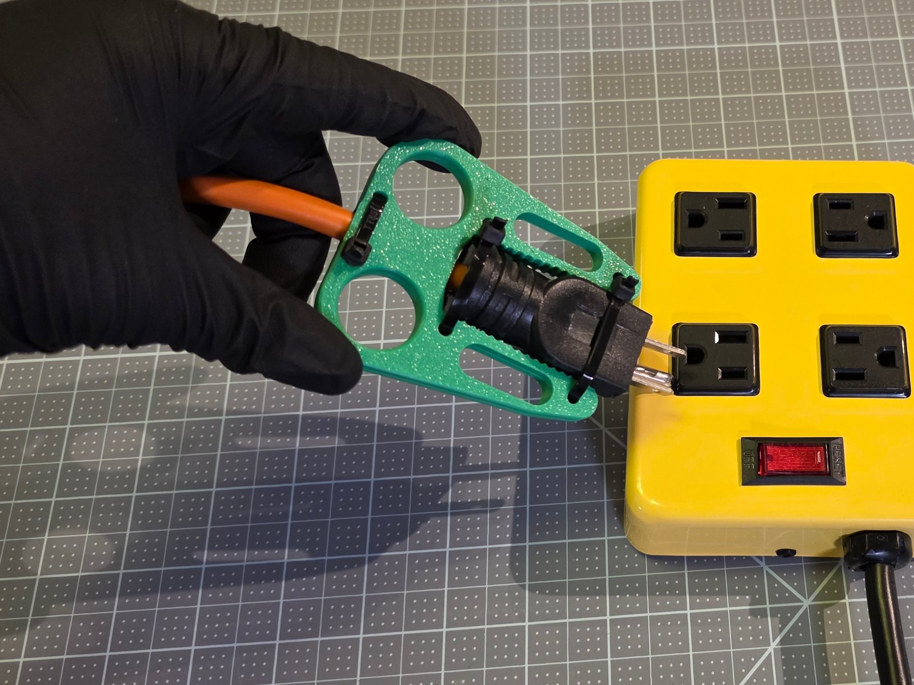

### Two tools: count the prongs

**The one-sided puller** is one printed part with a pocket the plug lies in, a cord hook, and holes for two zip ties or openings for a strap. It's for plugs with 2 prongs and USB-C tips. Presets: USB-C laptop tip, flat 2-prong lamp plug, wide 2-prong appliance plug.

**The two-sided puller** is two identical plates with toothed arms that zip-tie face to face around the plug. It's for plugs with 3 prongs, and any plug 24 mm thick or more. Presets: standard 3-prong plug, heavy-duty extension cord.

Each tool is its own customizable file on this listing: `Plug_Puller_One_Sided_SingleFile.scad` and `Plug_Puller_Two_Sided_SingleFile.scad`. Older versions switched between the tools with a setting; now you open the other file to get the other tool.

I split them this way after test prints. The one-sided puller held every 2-prong plug well, but 3-prong plugs kept slipping out of it. The two-sided puller held both 3-prong plugs really well, but every 2-prong plug and the USB-C tip fell out no matter how tight I ratcheted the zip ties: slippery PLA on a slippery USB-C, and the extra curves on a 2-prong plug, just don't give the teeth enough to grip. A 3-prong plug has long straight sides the teeth bite along their whole length. The USB-C preset is new and I haven't test-printed it yet.

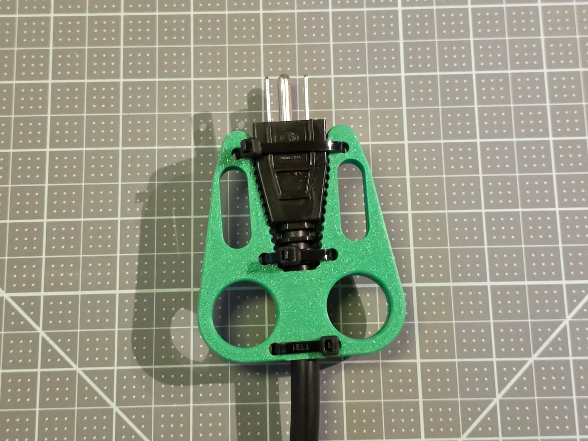

### What's new in version 1.0

- **Presets split by prong count.** Each tool carries only the plugs it holds, every preset measured with a caliper on a real plug.
- **A new USB-C laptop tip preset** on the one-sided puller.
- **A plug size finder.** One printable page with every preset's outline at true size: lay your plug on it to find your preset.
- **A better two-sided grip.** The gap keeps the plug's full width along its head, so a plug with a wide head is gripped along its whole side.
- **The full guide set.** A Maker Guide, an Assembly Guide By Touch, a Visual Assembly Guide and a User Guide, each a tagged PDF.

### Step 1: make the tool for your plug and hand

Press **Customize** on this listing and pick the file for your tool. The form is numbered so you just work top to bottom: **Step 1 - Your Plug** (a preset, or your plug's numbers in mm), **Step 2 - Size** (Small, Medium, Large, or your finger and hand widths), **Step 3 - Attachment**, and Step 4. Everything below Step 4 is optional. If a number can't work, the model prints red text right next to the part naming the measurement to fix, a classic one being inches typed instead of mm. Clear any red text before you download.

If you just read the word "OpenSCAD" and said "no thank you", that's completely fair: you never touch a line of code. The same form also runs in your browser in the OpenSCAD Assistive Forge, our own browser version of OpenSCAD built for keyboard and screen reader use, nothing to install, and in the free OpenSCAD desktop app. The links are below, and the download has a guide for each.

Not sure which preset? Print the plug size finder page at 100 %, check its 50 mm square, and lay your plug on the outlines. The STLs for every preset at all three hand sizes are in the repository too.

### Printing

**Settings.** Flat on the bed as the file comes, no supports, 0.2 mm layers, 3 to 4 walls, 25 to 35 % infill. PETG is my suggested start: it takes the small flex of every pull and the warmth near an outlet better than PLA. PLA works too; my test prints were PLA.

**The two-sided file holds both plates.** Print it as it is.

**Filament.** About 12 to 27 g a tool, depending on the plug and the hand size.

### Assembly

Two-sided puller: lay the plug on one plate between its toothed arms, turn the other plate over on top, thread three zip ties through both plates and across the plug, pull them tight and trim the tails. One-sided puller: seat it on the plugged-in plug with the plug in the pocket, hook the cord, and zip-tie or strap it on. The Maker Guide, the Assembly Guide By Touch and the Visual Assembly Guide in the download walk through it.

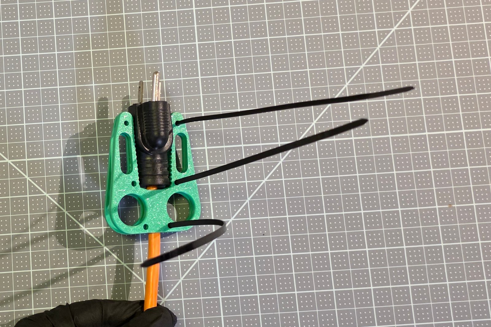

### Using it

Two fingers through the finger holes, and pull straight back, away from the outlet. Never lever it sideways. Don't use it on a damaged cord, a cracked plug, or a plug that's warm to the touch, and if the tool cracks, print a new one.

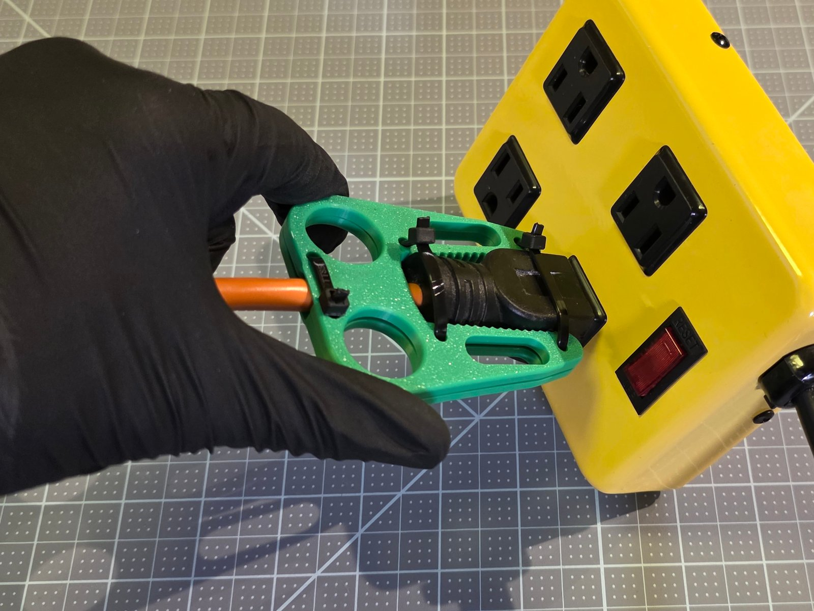

### If something doesn't fit

- **Plug rubs or won't go in:** add 1 mm to the plug width at the end that binds.
- **Plug slides out of a two-sided puller:** pull the ties tighter, or make the grip bite more negative.
- **A 3-prong plug slips out of a one-sided puller:** make a two-sided puller for it.
- **Fingers pinch in the holes:** go up one hand size.

Each tool's full guide has the whole table and decodes every red message.

### What's in the download

- Both customizable files, and the STLs for the presets.
- `Plug_Puller_Guides.zip`: the Step 1 guides (browser, desktop, MakerWorld), the Maker Guide, the Assembly Guide By Touch, the Visual Assembly Guide, the User Guide, the Device Summary and the Design Rationale as PDFs, plus each tool's quick start and full guide with the plug size finder and the measuring form at true size.

### Open hardware

The repository is under the PolyForm Noncommercial License 1.0.0: free for personal, educational and other noncommercial use. Downloads from this listing are under the license picked below. Full source, guides and the issue tracker: <https://github.com/BrennenJohnston/openscad-plug-puller>

The presets are all US (NEMA) plugs. The measure-it-yourself path may well work for other regions' plugs, but I haven't tested it, and there's lots of room for someone to adapt the geometry to European, UK or other plug families.

### Credits

- Device designed by Brennen Johnston.
- Hand sizing grounded in ANSUR II (2012) hand anthropometry.
- Made possible with support from the Washington Assistive Technology Act Program (WATAP), a statewide program that helps Washingtonians of all ages and abilities make informed decisions about, and gain access to, assistive technology: <https://watap.org/>
- Made possible with support from the University of Washington Center for Research and Education on Accessible Technology and Experiences (UW CREATE), an interdisciplinary research center whose mission is to make technology accessible and to make the world accessible through technology: <https://create.uw.edu/>

If you build one, please post a comment or a make. Thank you!

## 4. Category

Health & Personal Care, then Assistive Devices; Tools, then Hand Tools, if that is not offered.

## 5. License

Creative Commons Attribution-NonCommercial-ShareAlike 4.0 (CC BY-NC-SA 4.0).

## 6. Tags

assistive technology, accessibility, arthritis, grip aid, plug puller, outlet, parametric, openscad, customizer, adaptive equipment, occupational therapy

## 7. External links

- The source repository: <https://github.com/BrennenJohnston/openscad-plug-puller>
- The one-sided puller in the browser: <https://openscad-assistive-forge.pages.dev/?manifest=https://raw.githubusercontent.com/BrennenJohnston/openscad-assistive-forge/example-manifest/plug-puller/forge-manifest-one-sided.json>
- The two-sided puller in the browser: <https://openscad-assistive-forge.pages.dev/?manifest=https://raw.githubusercontent.com/BrennenJohnston/openscad-assistive-forge/example-manifest/plug-puller/forge-manifest-two-sided.json>

## 8. Print profiles

None yet: a profile needs a sliced project of a real print, and the Medium presets have not been sliced. Each profile added later needs a photograph of its real print.

## 9. Pictures

From `MakerWorld_Photos/`, written by `scripts/makerworld_photos.py`. The covers and the real photos are photographs of the printed tools; the renders go only in the renderings section.

Desktop cover, `Cover/1_desktop_4x3.jpg`:

App cover, `Cover/2_mobile_3x4.jpg`:

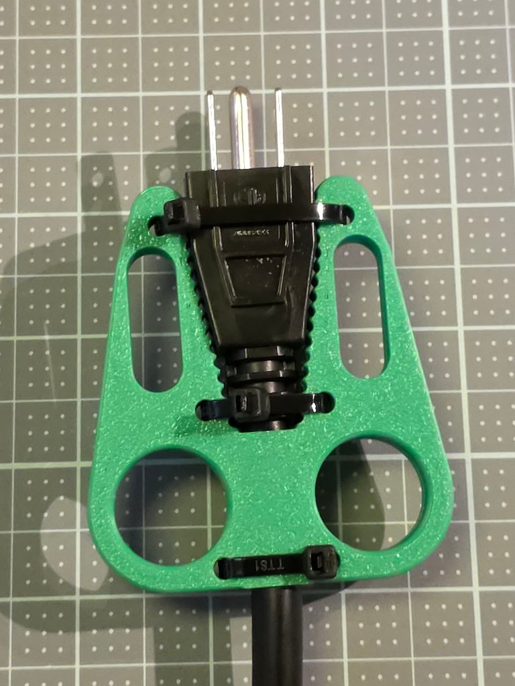

Real photo 1, the front view, the whole printed object, `Real_Photos/01_front_both_plates.jpg`:

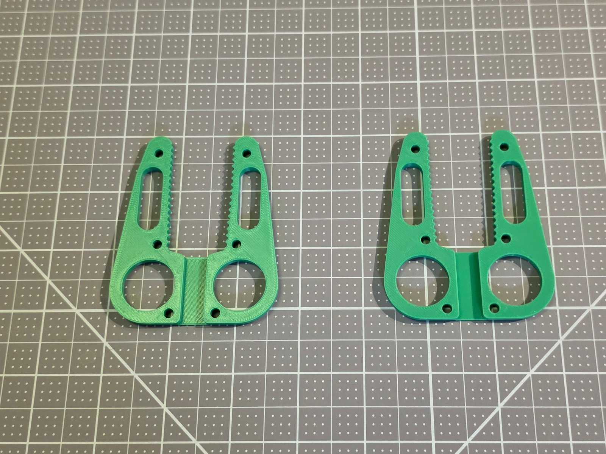

Real photo 2, the top view, `Real_Photos/02_top_finished_standard_plug.jpg`:

Real photo 3, the top view on the heavy-duty plug, `Real_Photos/03_top_finished_heavy_duty_plug.jpg`:

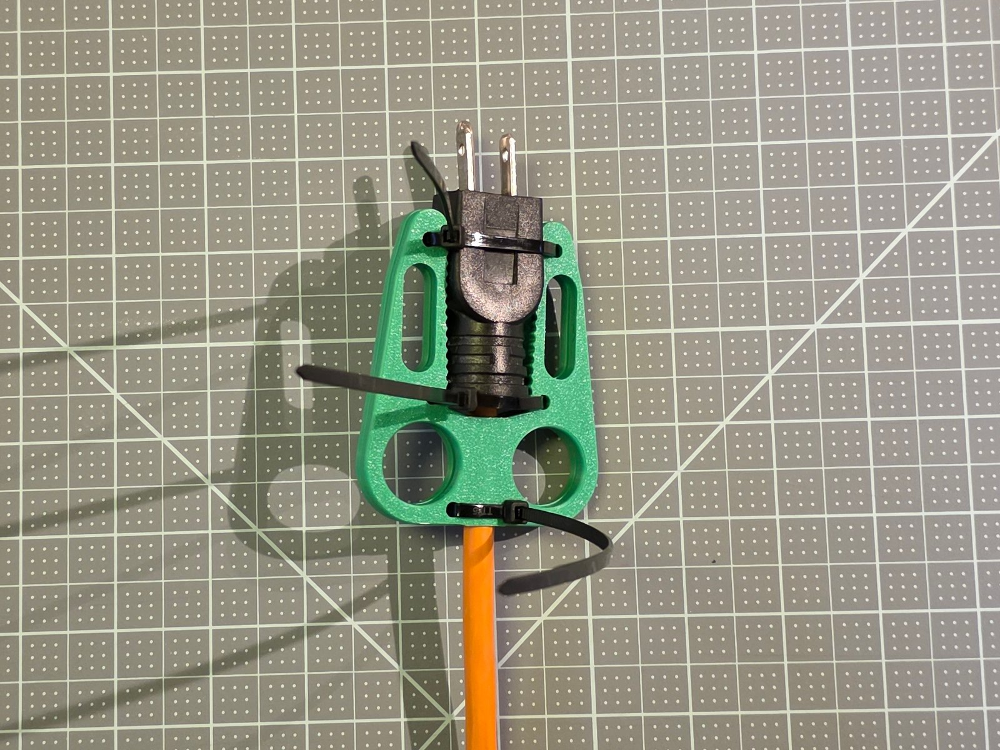

Real photo 4, the side view, `Real_Photos/04_side_pulling_heavy_duty_plug.jpg`:

Real photo 5, `Real_Photos/05_pulling_standard_plug.jpg`:

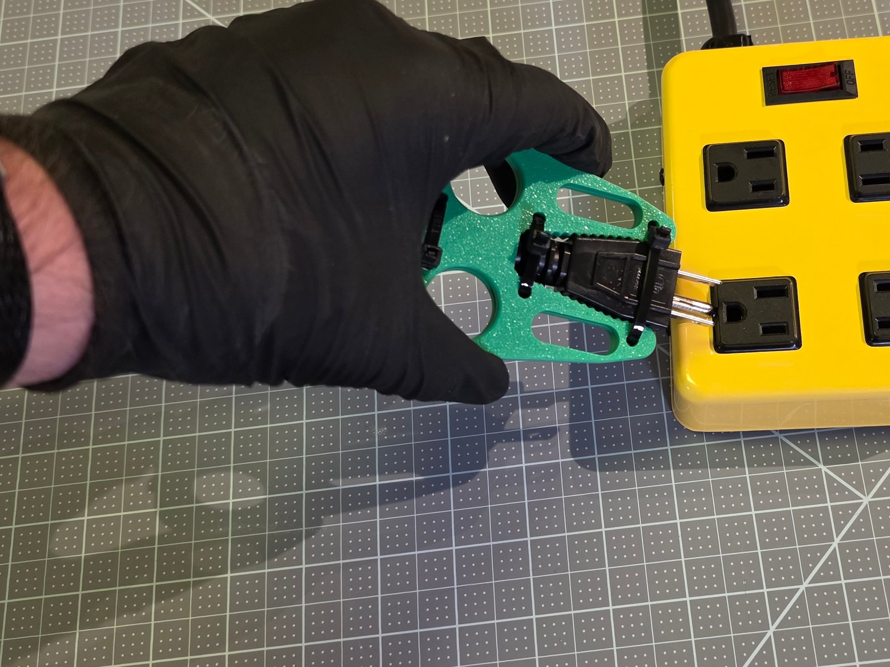

Real photo 6, `Real_Photos/06_plates_and_heavy_duty_plug.jpg`:

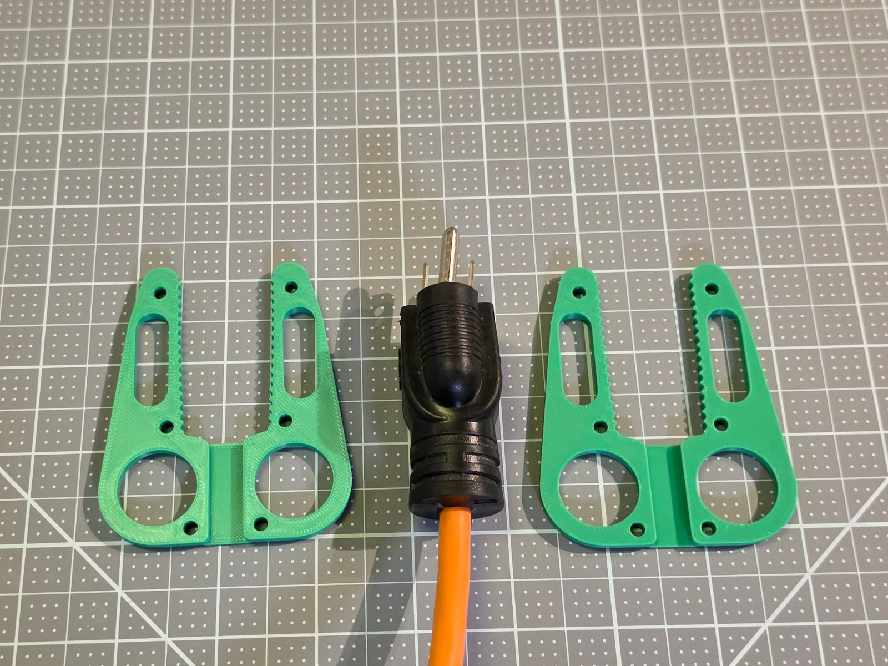

Real photo 7, the one-sided puller, `Real_Photos/07_one_sided_on_lamp_plug.jpg`:

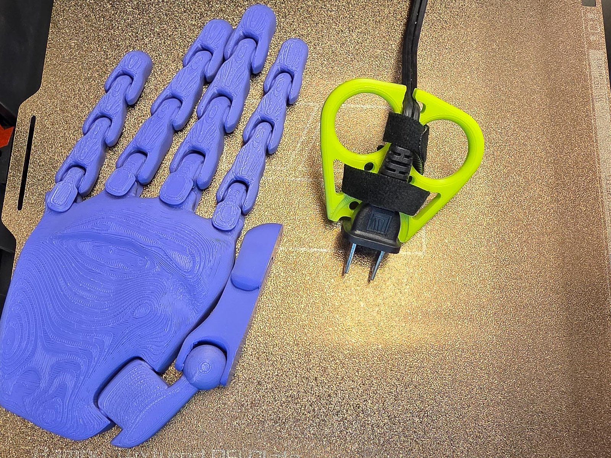

Rendering 1, `Renders/01_two_sided_standard_plug_medium.png`:

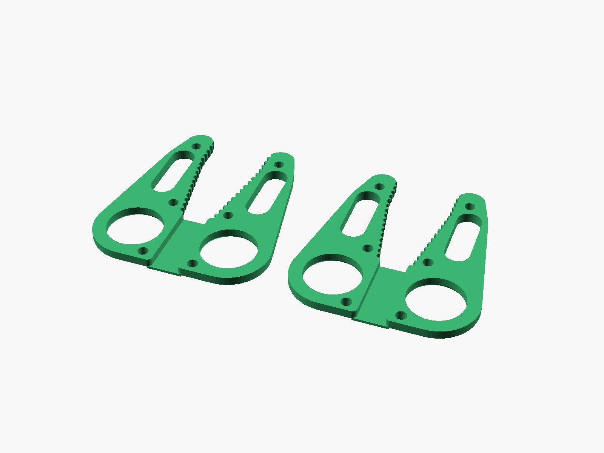

Rendering 2, `Renders/02_two_sided_heavy_duty_plug_medium.png`:

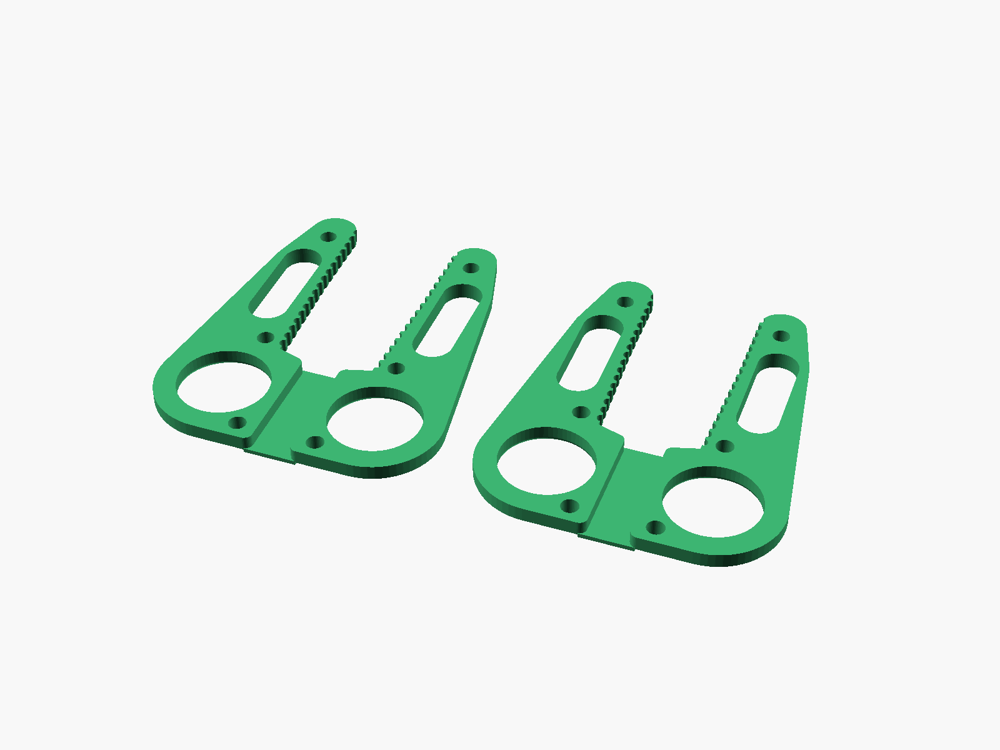

Rendering 3, `Renders/03_one_sided_lamp_plug_medium.png`:

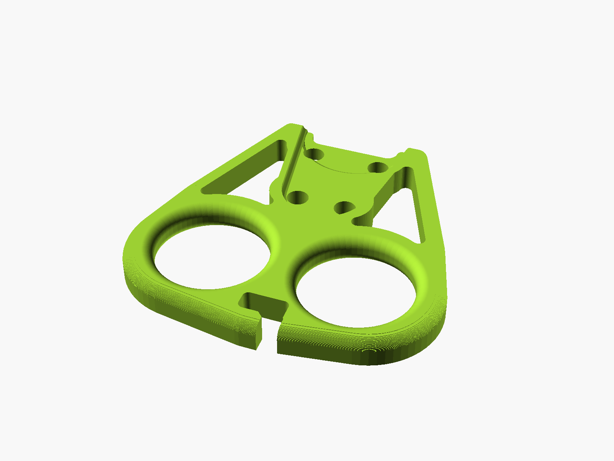

Rendering 4, `Renders/04_one_sided_usb_c_tip_medium.png`:

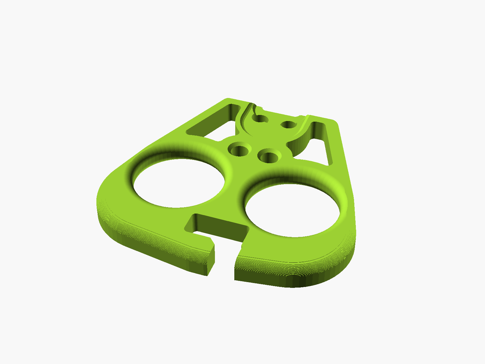

## 10. Videos

None at this release. A cut under 30 seconds of the July 2026 assembly recording is offered for a later update, after the owner has watched it.

## 11. Files to upload

| Slot | Files |
|---|---|
| Model files | the 15 STLs of `stl/Plug-Puller/`, or the release ZIP of them |
| Model files, ZIPs | `Plug_Puller_Guides.zip`, written by `scripts/makerworld_bundle.py` |
| Print profiles | none yet |
| Parametric Model Maker | `dist/Plug_Puller_One_Sided_SingleFile.scad` and `dist/Plug_Puller_Two_Sided_SingleFile.scad`, each its own customizable file |
| Video | none yet |
