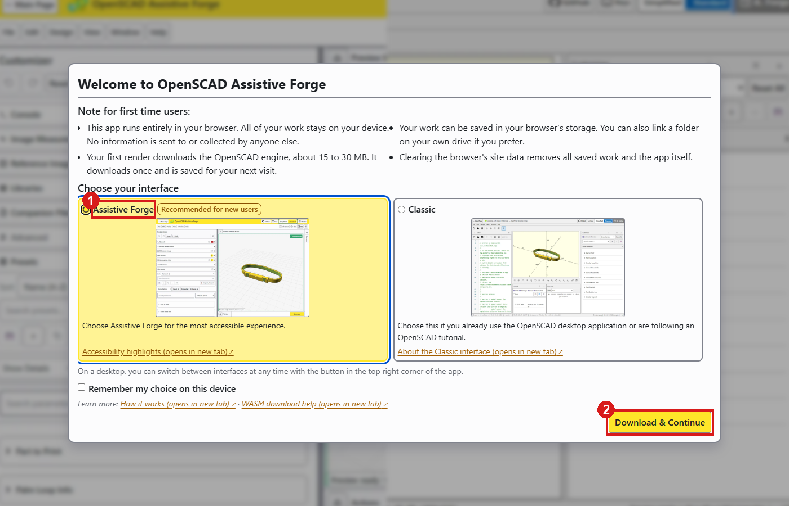
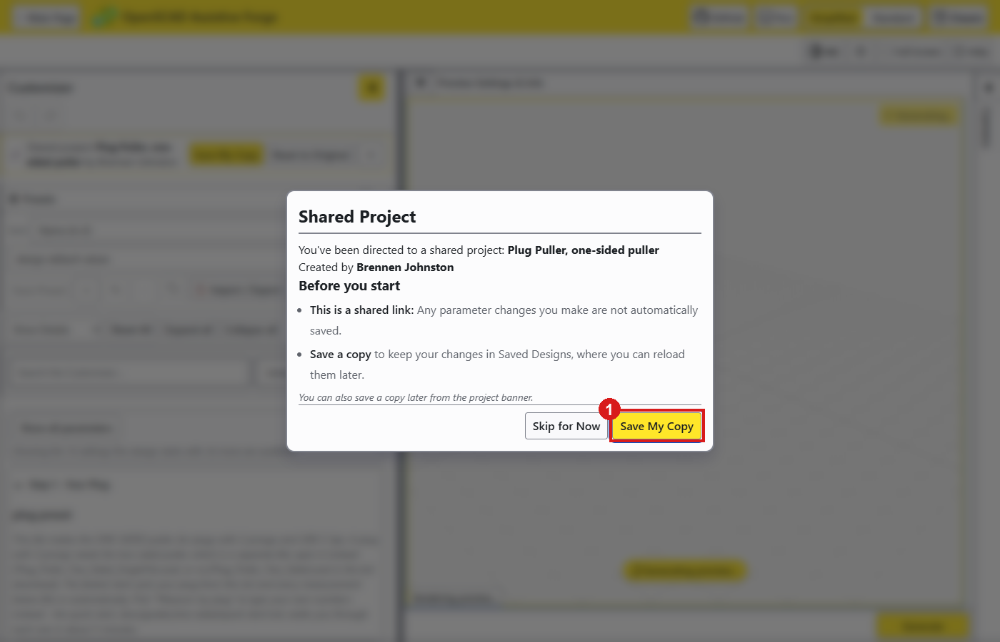
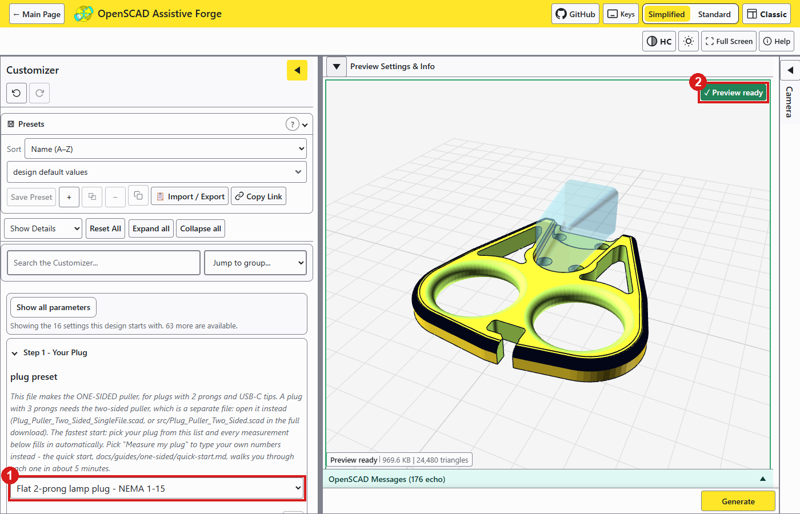
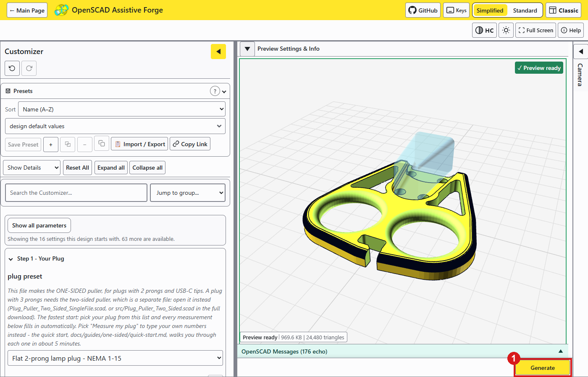
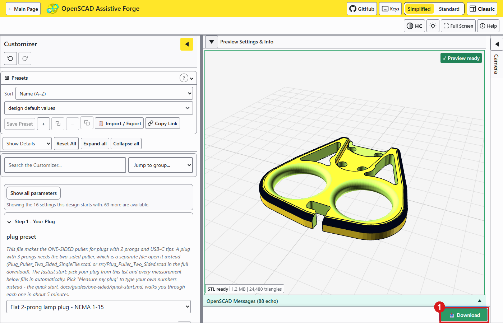

# Browser Customizer Guide

How to make a Plug Puller for one plug and one hand in a web browser, with nothing to install, and download it as an STL file to print. The [OpenSCAD Guide](Step_1_Guide_Option_2_Plug_Puller_OpenSCAD_Guide.md) does the same in the free desktop program.

## What you are making

The Plug Puller is a 3D-printed tool for pulling an electrical plug out of an outlet with the whole hand instead of a fingertip pinch: two fingers go through two finger holes and pull straight back, and the tool touches only the plug's sides and back, never the outlet. It comes as two tools, each its own file, made for a measured plug and hand: the one-sided puller, one printed part, for plugs with 2 prongs and USB-C tips; and the two-sided puller, two printed plates zip-tied around the plug, for plugs with 3 prongs.

## What the browser customizer is

The OpenSCAD Assistive Forge is a version of OpenSCAD that runs in a web browser, on a computer or a phone, built for keyboard and screen reader use. Your numbers stay on your device; nothing is uploaded. Its first visit downloads an engine of about 15 to 30 MB, once. The pictures below show the one-sided puller; the two-sided puller's link opens the same screens with its own Step 1.

## Make the tool in the browser

### Step 1: Count the prongs and open the tool's link

A plug with 2 prongs, or a USB-C tip, takes the one-sided puller; a plug with 3 prongs, or any plug 24 mm thick or more, takes the two-sided puller. Each tool is its own file with its own link, and no setting inside one makes the other:

- the one-sided puller: [open it in the Assistive Forge](https://openscad-assistive-forge.pages.dev/?manifest=https://raw.githubusercontent.com/BrennenJohnston/openscad-assistive-forge/example-manifest/plug-puller/forge-manifest-one-sided.json)
- the two-sided puller: [open it in the Assistive Forge](https://openscad-assistive-forge.pages.dev/?manifest=https://raw.githubusercontent.com/BrennenJohnston/openscad-assistive-forge/example-manifest/plug-puller/forge-manifest-two-sided.json)

### Step 2: Choose the interface

On a first visit the Forge asks which interface to use.

1. Choose **Assistive Forge** (1).
2. Press **Download & Continue** (2).

The Classic choice works too and looks like the desktop program; this guide follows Assistive Forge.

### Step 3: Keep a copy

The Forge offers to keep a copy of the tool in the browser. **Save My Copy** (1) lists it on the Forge's main page whenever you come back, no link needed; **Skip for Now** works for a single tool.

### Step 4: Fill in the four steps

The form shows the four steps' settings first, top to bottom: **Step 1 - Your Plug**, **Step 2 - Size**, **Step 3 - Attachment** and Step 4 (the one-sided puller's cord hook side, or the two-sided puller's print layout). Everything else sits behind **Show all parameters** and is optional.

1. In **plug preset** (1), pick your plug if it is on the list: every plug number fills in. Otherwise leave **Measure my plug** and type your numbers into the fields below it, in mm.
2. Pick the hand size in Step 2, the attachment in Step 3, and Step 4.
3. Wait for **Preview ready** (2) over the preview after each change.

What each setting does, how to measure each number, and a picture of what every setting moves are in each tool's quick start and full guide: [one-sided quick start](../docs/guides/one-sided/quick-start.md), [two-sided quick start](../docs/guides/two-sided/quick-start.md). The see-through plug in the preview is drawn from your numbers; it is never part of the download.

**Check:** no red text lies beside the tool in the preview. Red text names a number to fix; each tool's full guide decodes every message.

### Step 5: Generate and download the STL

1. Press **Generate** (1) below the preview and wait for it to finish.
2. Press **Download** (1), which takes its place, and save the STL file.

The two-sided puller's file holds both plates. Printing and putting the tool on the plug are in the [Maker Guide](Step_2_Guide_Option_3_Plug_Puller_Maker_Guide.md).
