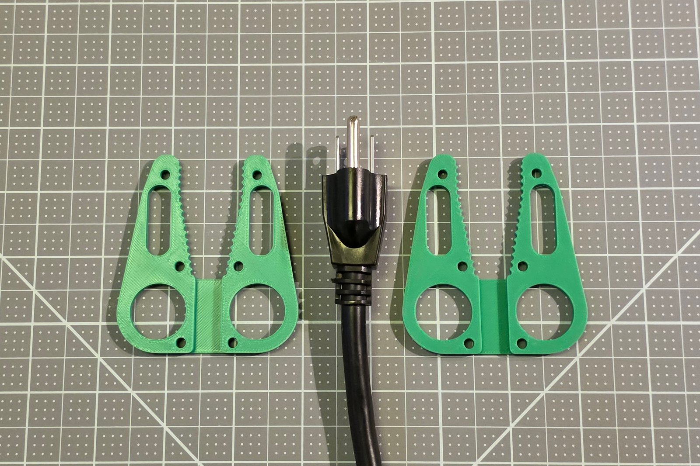
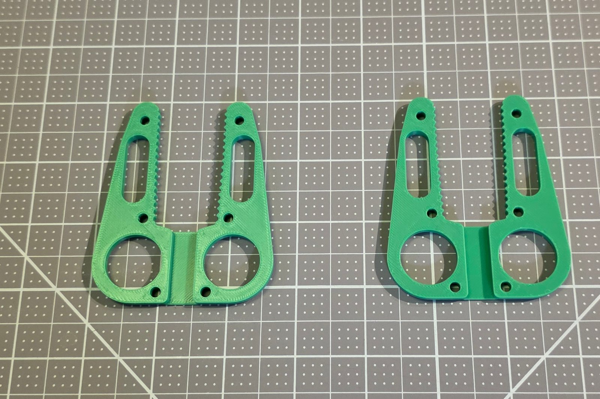
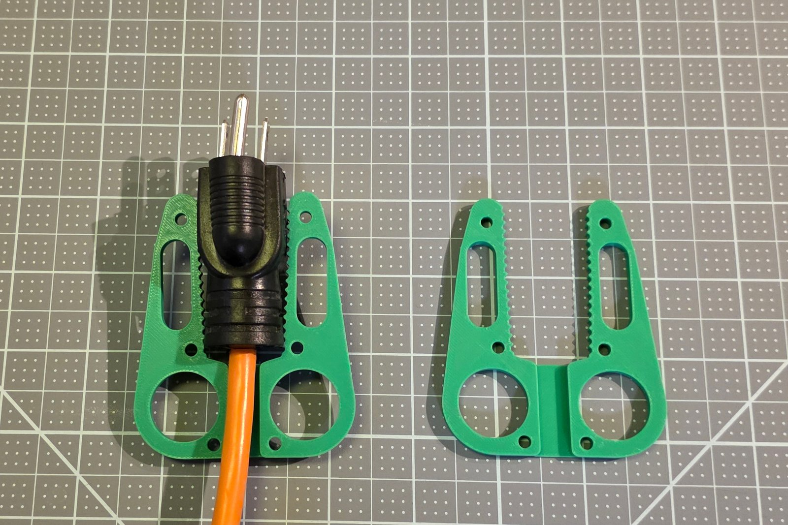
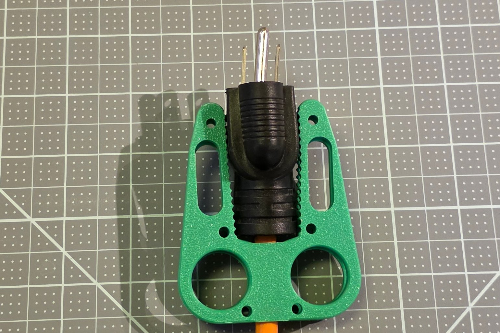
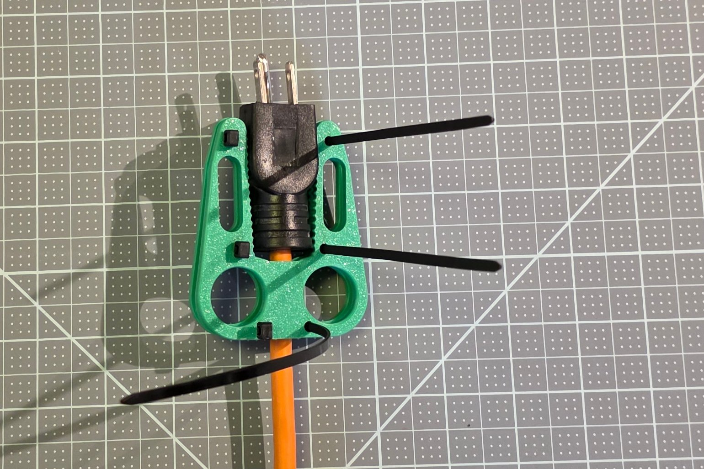
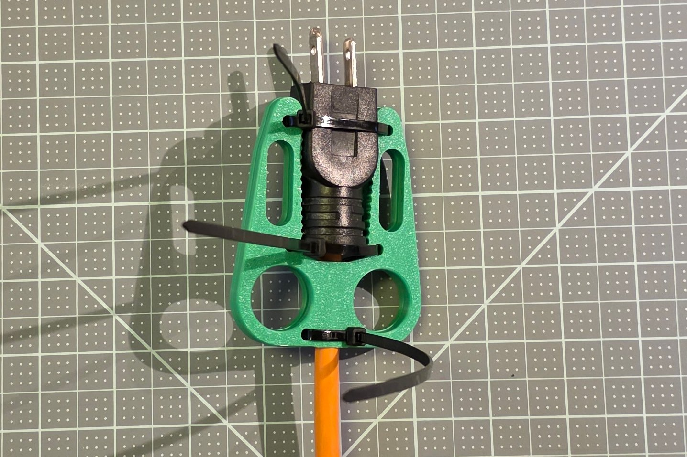
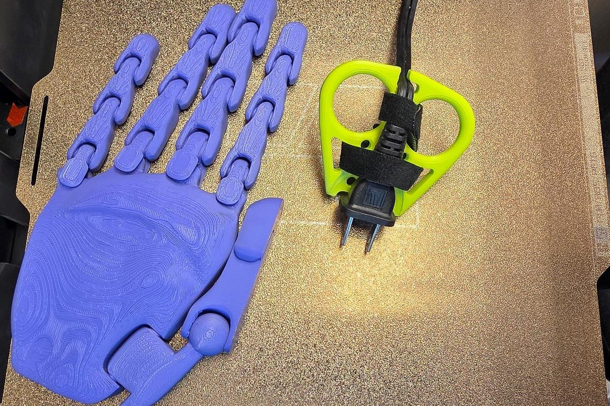

# Visual Assembly Guide

The Plug Puller's assembly as pictures only, one a step, in the order of the Maker Guide's steps; the words are in the Maker Guide and the Assembly Guide By Touch.

## 1. Parts

The two-sided puller: two identical plates, the 3-prong plug they were made for, and three zip ties. The one-sided puller is one part, held on its 2-prong plug by two zip ties or a strap.

## 2. The two-sided puller

## 3. The one-sided puller

<!-- shot: stage-one-sided-steps | angle: standard | show: the one-sided puller seated, the cord hooked, the ties pulled; one picture each -->
