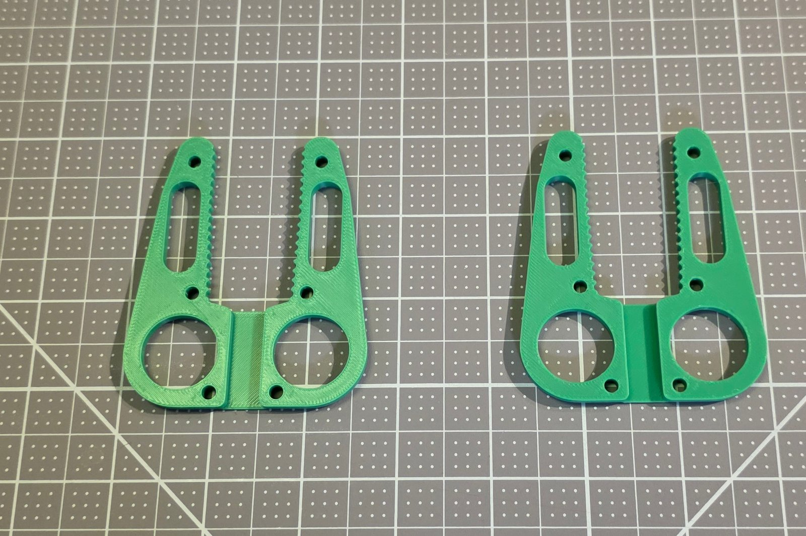
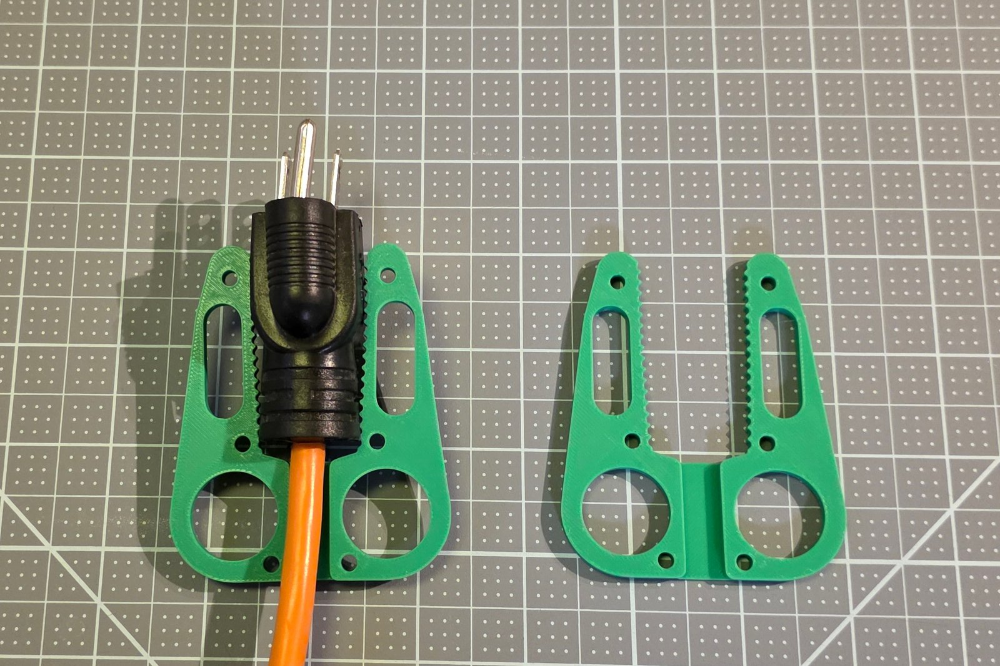
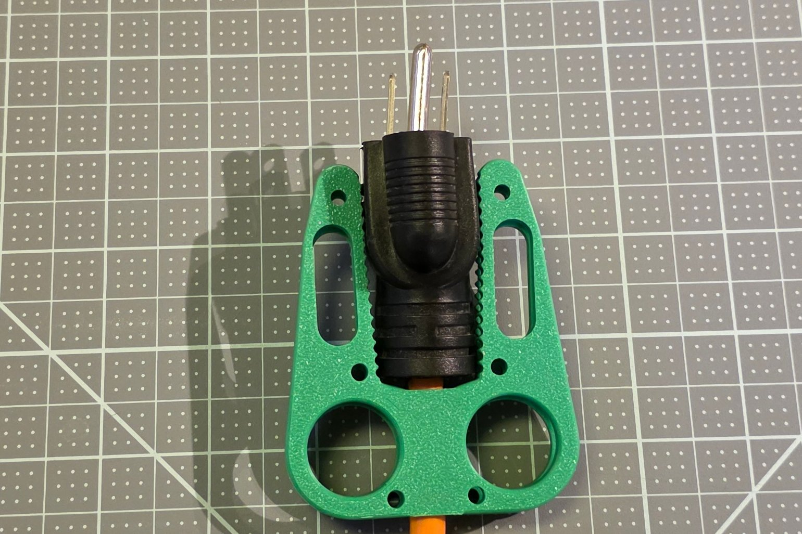
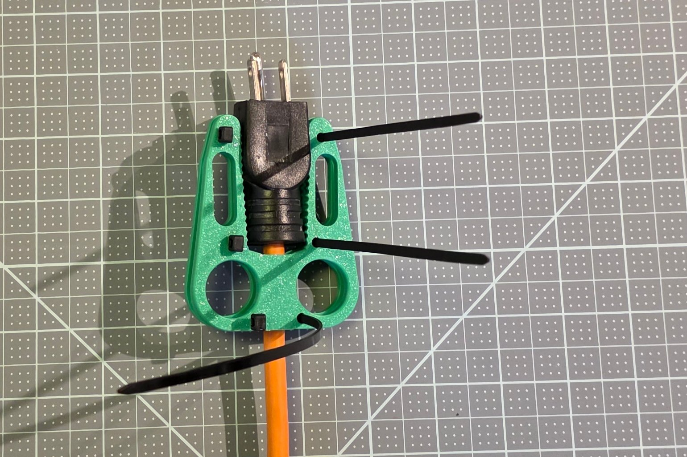
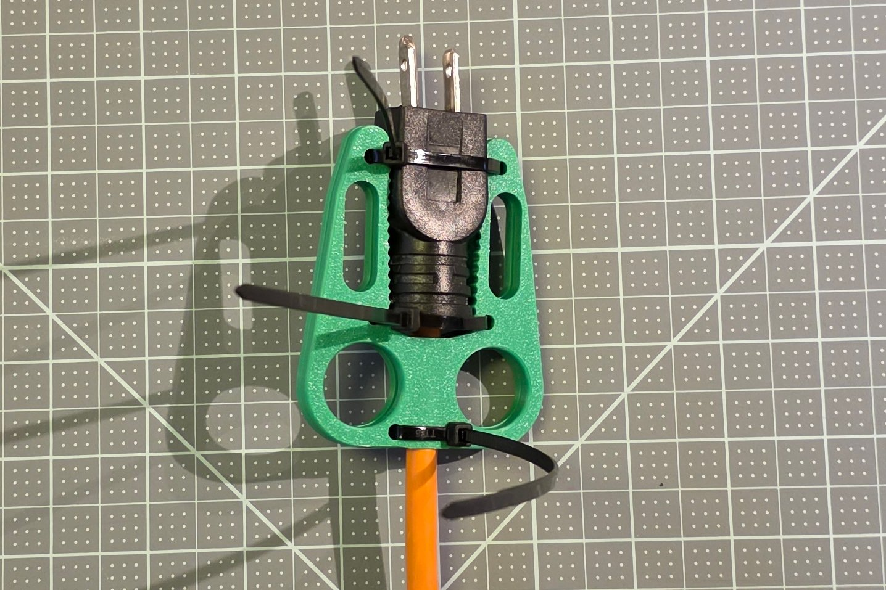
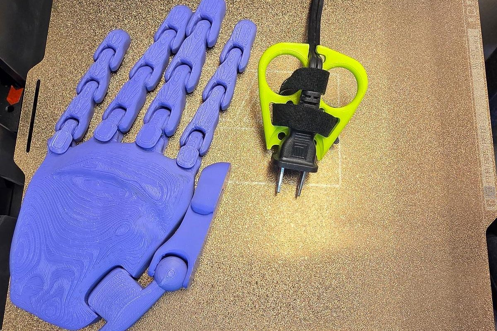

# Assembly Guide By Touch

How to put a printed Plug Puller on its plug with the hands alone: every part described for the fingers, every step with what to feel when it is right. This is the full edition; the Maker Guide is the short one and the Visual Assembly Guide the one without words.

## What you are making

The Plug Puller is a 3D-printed tool for pulling an electrical plug out of an outlet with the whole hand instead of a fingertip pinch: two fingers go through two finger holes and pull straight back, and the tool touches only the plug's sides and back, never the outlet. It comes as two tools, each made for one measured plug and hand. The two-sided puller is two identical flat plates zip-tied face to face around a plug with 3 prongs. The one-sided puller is one flat part with a pocket the plug lies in, for a plug with 2 prongs or a USB-C tip. Either tool stays on its plug between uses. Printing the tool is in the [Maker Guide](Step_2_Guide_Option_3_Plug_Puller_Maker_Guide.md).

## How this guide names directions

For the two-sided puller, sit at a table with a plate lying flat in front of you, its two finger holes nearest you and its two arms reaching away from you. Near is the finger-hole end, where the cord leaves the plug; far is the end of the arm tips, where the prongs go. Left and right are your own left and right. Up is away from the table.

For the one-sided puller, stand or sit facing the wall outlet with the plug in it. In is toward the outlet, out is away from it.

## The parts, by touch

### The plate of the two-sided puller

A flat plate about 4 mm thick and about the size of a palm: about 68 mm across and 76 mm long for the standard 3-prong plug at Medium. At the near end are two round finger holes side by side, each wider than a finger, with smooth rounded rims. Between them a narrow slot, the cord channel, runs from the near edge toward the middle. From the finger holes two arms reach to the far end, with a gap between them where the plug lies. Along the inner edge of each arm runs a row of small rounded teeth, close together, easy to feel with a fingertip.

Along each arm are small round holes about 4 mm across, the zip-tie holes: one near the far tip, one in the middle of the arm, and one beside the cord channel at the near end. Outside the teeth, each arm has a long narrow slot for an optional strap; on a short plug the slot is left out.

The two faces differ. On the outer face the edges are rounded all around and the cord channel is closed at the near end by a thin floor. On the inner face the edges are square and the cord channel is an open groove. The two plates of a pair are the same part, and they go inner face to inner face, with the plug between them.

### The one-sided puller

A flat part about 6 mm thick, a little smaller than a palm: about 72 mm across and 71 mm long at Medium. At one end, the plug end, a shallow pocket the shape of the plug's wide side is sunk into one face, open to the end edge, and a shallow notch is cut into that edge. In the middle are two large round finger holes side by side with rounded rims. At the other end, the cord end, a narrow slot opens from the edge and turns sideways, like the letter J: the cord hook.

Beside the pocket are two pairs of small round holes about 5 mm across, the zip-tie holes. Outside them, one each side, are two large curved triangular openings, the wing openings, for a strap. The face with the pocket has rounded edges; the other face is flat, with square edges.

### Zip ties and the strap

A zip tie is a thin plastic strip with a square head at one end; the tail goes through the head and holds when pulled. The two-sided puller takes three ties up to 3.6 mm wide and about 200 mm long; the one-sided puller takes two ties up to 4.8 mm wide, or one hook-and-loop strap 10 to 25 mm wide. Side cutters trim the tails.

## Assemble the two-sided puller

### Step 1: Lay the first plate outer face down

Lay one plate flat on the table, finger holes nearest you, its rounded-edge face down.

**Check:** the edge under your fingertip is square on top, and the cord channel is an open groove you can trace from between the finger holes toward the arms.

**By touch:** run a fingertip along the plate's edge. The face against the table has the rounded edge; the face up has the square edge.

Both plates are the same part: one is turned over in Step 3 so their teeth face each other.

### Step 2: Lay the plug between the arms

Lay the plug in the gap between the arms, its prongs pointing away from you past the arm tips, and press its cord into the groove between the finger holes.

**Check:** the plug's sides touch the teeth of both arms, and the cord lies flat in the groove.

**By touch:** the prongs stick out beyond the far ends of the arms; the cord runs toward you between the two finger holes.

The plug lies between the arms of the first plate, its prongs toward the arm tips and its cord in the channel between the finger holes.

### Step 3: Lay the second plate on top

Turn the second plate rounded-edge face up, finger holes nearest you, and lay it on the plug so it covers the first plate.

**Check:** a finger pushed through a finger hole passes straight through both plates.

**By touch:** run a finger around the outside edge of the pair: the two plates meet with no step where one sticks out, and the rounded edges are on the outside, top and bottom.

The second plate is turned over and laid on top, its outline over the first plate's and its teeth on the plug.

### Step 4: Thread the three zip ties

You need three zip ties.

1. Push the tail of the first tie down through the zip-tie hole near the tip of the left arm, through both plates.
2. Bring it under the pair to the right arm, and up through the matching hole there, through both plates.
3. Bring it back over the top plate, across the plug, and push the tail into the tie's own head, a few clicks only.
4. Do the same with the middle holes and with the holes beside the cord channel.

**Check:** each tie crosses over the plug and comes back to its own head; three ties, three pairs of holes.

**By touch:** the zip-tie holes are the small round holes along the arms, outside the teeth; the strap slot is the long one beside them, and the ties do not go through it.

Each tie goes down through a hole of the top plate and the matching hole of the plate under it.

### Step 5: Pull the ties tight

Pull each tie's tail a little at a time, going from tie to tie, until the plug no longer moves between the plates.

**Check:** nothing moves when you push the prongs toward you or pull the cord away from you.

**By touch:** squeeze the pair at the arm tips: the plates do not open.

The ties are pulled tight, a little at a time on each, until the plug no longer moves between the plates.

### Step 6: Cut the tails

**Careful:** a tail cut at an angle leaves a sharp point; cut straight across, close to the head, with the cutter's flat side against the head.

Cut each tie's tail close to its head.

**Check:** a fingertip run over each tie's head meets no sharp point.

The finished puller stays on the plug, the finger holes free; the tie tails are trimmed.

## Fit the one-sided puller

The one-sided puller goes on the plug while the plug is in its outlet.

### Step 1: Seat the tool on the plug

**Careful:** touch only the plug's plastic body and the tool; the prongs stay inside the outlet.

Hold the tool by its finger holes, pocket face toward the plug, plug end toward the outlet, and slide it on so the plug lies in the pocket and the tool's end edge rests against the outlet cover.

**Check:** the tool lies flat against the plug's wide side and does not rock.

**By touch:** the notch in the tool's end edge sits over the outlet cover's raised middle; the plug's sides sit inside the pocket's walls.

<!-- shot: stage-one-sided-seated | angle: standard | show: the one-sided puller seated on a lamp plug at a wall outlet, the notch over the cover plate -->

### Step 2: Hook the cord

Press the cord into the slot at the cord end and slide it along the slot's sideways turn.

**Check:** the cord stays in the hook when you let go.

**By touch:** the slot opens at the end edge, a little off the middle, and turns sideways; the cord sits in the turn.

### Step 3: Tie or strap it on

You need two zip ties, or the strap.

1. Push a zip tie's tail down through a zip-tie hole beside the pocket, around the back of the plug body, and up through the hole on the other side of the pocket.
2. Push the tail into the tie's head and pull it tight; cut the tail close to the head.
3. Do the same with the second pair of holes.
4. Instead, or as well, thread the strap through the two wing openings, around the plug, and close it.

**Check:** the plug does not move in the pocket when you pull the tool gently out by its finger holes.

**By touch:** the zip-tie holes are the four small round holes around the pocket, two each side; the wing openings are the two large curved openings outside them.

The one-sided puller at Small size on a 2-prong lamp plug.

## If something does not fit

Each tool's full guide has the table of fixes, each naming one number to change in the customizer: [one-sided puller](../docs/guides/one-sided/full-guide.md#if-the-print-does-not-fit), [two-sided puller](../docs/guides/two-sided/full-guide.md#if-the-print-does-not-fit). The [User Guide](Step_3_Guide_Plug_Puller_User_Guide.md) teaches the pull.
