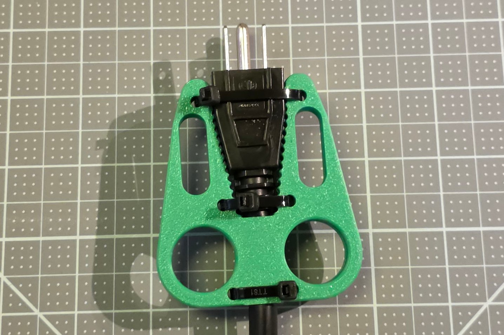
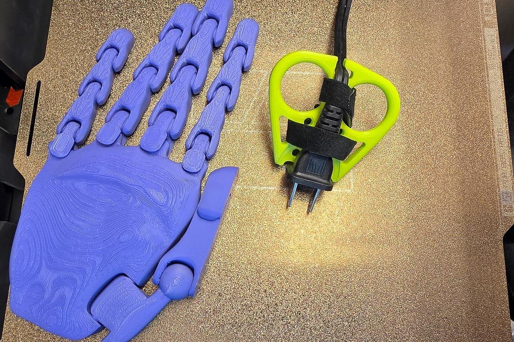
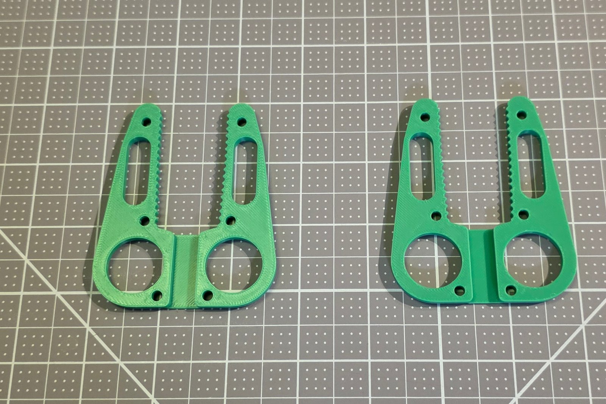
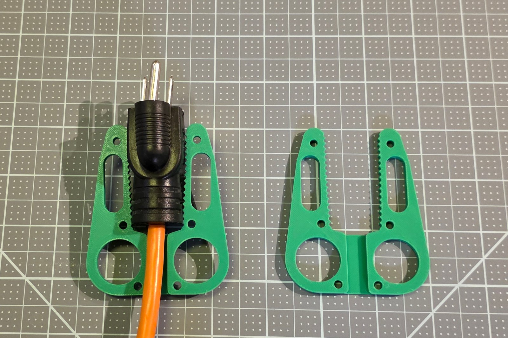
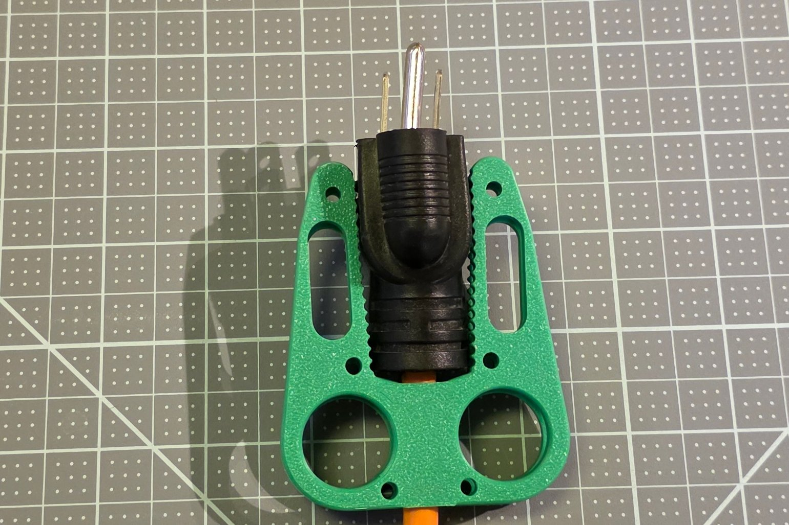
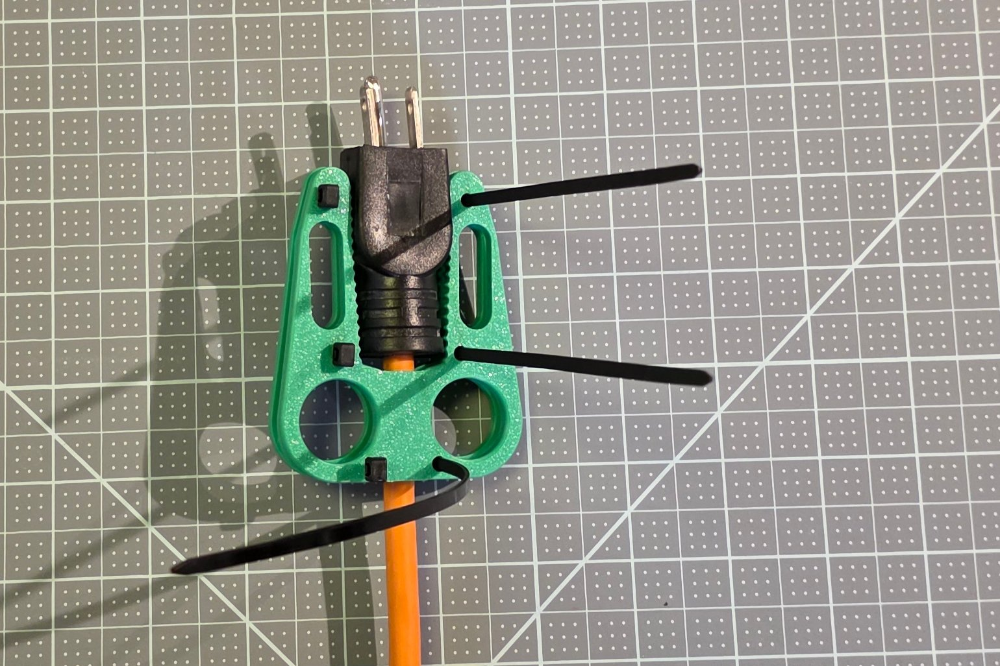
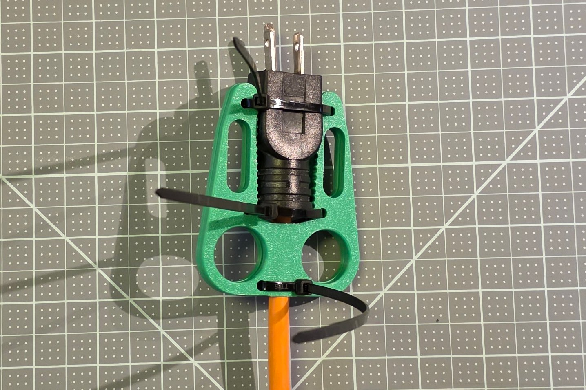
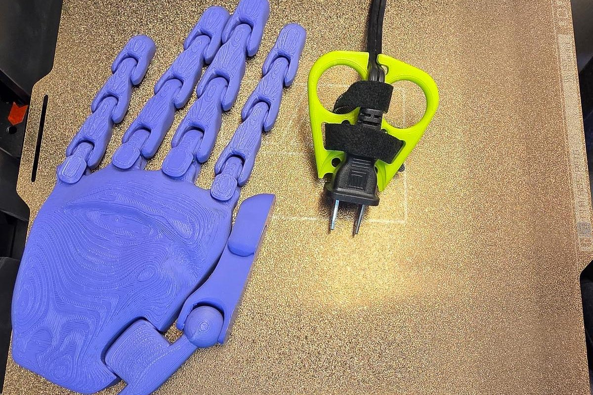

# Maker Guide

How to make a Plug Puller: count the plug's prongs to pick the tool, make the tool for that plug and hand in a customizer, print it, and fit it on the plug. This is the short edition; the Assembly Guide By Touch says every step for the hands, and the Visual Assembly Guide shows it without words.

## 1. What you are making

The Plug Puller is a 3D-printed tool for pulling an electrical plug out of an outlet with the whole hand instead of a fingertip pinch: two fingers go through two finger holes and pull straight back, and the tool touches only the plug's sides and back, never the outlet. It comes as two tools, each its own customizer file, made for a measured plug and hand. The one-sided puller is one printed part with a pocket the plug lies in, for plugs with 2 prongs and USB-C tips. The two-sided puller is two identical printed plates zip-tied face to face around the plug, for plugs with 3 prongs. Either tool stays on its plug between uses.

The two-sided puller on a standard 3-prong plug: two plates, three zip ties, the finger holes at the cord end.

The one-sided puller on a 2-prong lamp plug: the plug lies in the pocket, a strap holds it, and the cord sits in the hook.

## 2. Pick the tool by counting the prongs

| The plug | The tool | Its file | Presets |
|---|---|---|---|
| 2 prongs, or a USB-C tip | One-sided puller | `Plug_Puller_One_Sided_SingleFile.scad` | USB-C laptop tip; flat 2-prong lamp plug; wide 2-prong appliance plug |
| 3 prongs, or any plug 24 mm thick or more | Two-sided puller | `Plug_Puller_Two_Sided_SingleFile.scad` | standard 3-prong plug; heavy-duty extension cord |

The two tools are separate files, and no setting inside one file makes the other tool. In the full download the same files are `src/Plug_Puller_Parametric.scad` (one-sided) and `src/Plug_Puller_Two_Sided.scad` (two-sided). Why the line falls at the prong count, from test prints, is in the [Design Rationale](Plug_Puller_Design_Rationale.md). The USB-C laptop tip preset is new in version 1.0.0 and has not been test-printed yet.

To pick a preset without measuring, print the plug size finder page at 100 % ([`docs/guides/plug-size-finder.svg`](../docs/guides/plug-size-finder.svg), also the last pages of each quick start PDF), check its 50 mm square with a ruler, and lay the plug on the outlines of its group. A plug that matches no outline is measured instead, with the measuring form in each tool's quick start.

## 3. Make the tool for the plug and the hand

Making the tool is Step 1 of the project, with a guide for each place to do it: the [Browser Customizer Guide](Step_1_Guide_Option_1_Plug_Puller_Browser_Customizer_Guide.md) (nothing to install), the [OpenSCAD Guide](Step_1_Guide_Option_2_Plug_Puller_OpenSCAD_Guide.md) (the free desktop program) and the [MakerWorld Guide](Step_1_Guide_Option_3_Plug_Puller_MakerWorld_Guide.md). Each ends with an STL file to print.

For a preset plug and a Small, Medium or Large hand, the STL is already made: [`stl/Plug-Puller/`](../stl/Plug-Puller) holds all 15, named by plug and size, and [`stl/README.md`](../stl/README.md) lists them. Medium is the reference size; Small fits about a 5th-percentile female hand and Large about a 95th-percentile male hand.

## 4. Print it

| Setting | Value |
|---|---|
| Orientation | Flat on the bed as the file comes, no supports; the one-sided puller pocket side up, the two-sided plates outer face down |
| Layer height | 0.2 mm |
| Walls | 3 to 4 |
| Infill | 25 to 35 %, cubic or gyroid |
| Material | PETG; PLA works too |

PETG is the suggested start because it takes the small flex of every pull and the warmth near an outlet better than PLA; the test prints were PLA and held. The filament each tool uses, about 12 to 27 g, is in the [bill of materials](Plug_Puller_BOM.csv). The two-sided file holds both plates; print the file as it is.

## 5. Assemble the two-sided puller

Sit at a table with the two plates flat in front of you, toothed arms pointing away from you. You need three zip ties up to 3.6 mm wide and about 200 mm long, and side cutters for the tails.

### Step 1: Lay out the plates

Lay both plates flat, the toothed arms pointing away from you.

Both plates are the same part: one is turned over in Step 3 so their teeth face each other.

### Step 2: Lay the plug on the first plate

Lay the plug between the arms of the first plate, prongs past the arm tips and the cord in the channel between the finger holes.

The plug lies between the arms of the first plate, its prongs toward the arm tips and its cord in the channel between the finger holes.

### Step 3: Turn the second plate over onto the plug

Turn the second plate over and lay it on top, its outline over the first plate's.

**Check:** the finger holes of the two plates line up, and the plug sits between both pairs of arms.

The second plate is turned over and laid on top, its outline over the first plate's and its teeth on the plug.

### Step 4: Thread the zip ties

Thread each zip tie down through a hole on one side of both plates, under the pair, up through the matching holes on the other side, and into its own head, so it crosses over the plug.

Each tie goes down through a hole of the top plate and the matching hole of the plate under it.

### Step 5: Pull the ties tight

Pull the ties tight, a little at a time on each, until the plug no longer moves between the plates.

The ties are pulled tight, a little at a time on each, until the plug no longer moves between the plates.

### Step 6: Cut the tails

Cut the tie tails off close to their heads.

The finished puller stays on the plug, the finger holes free; the tie tails are trimmed.

## 6. Fit the one-sided puller

The one-sided puller goes on the plug while the plug is in its outlet. You need two zip ties up to 4.8 mm wide and about 200 mm long, or a hook-and-loop strap 10 to 25 mm wide.

### Step 1: Seat the tool on the plug

Hold the tool pocket side to the plug and slide it on: the plug lies in the pocket, and the notch at the pocket end straddles the outlet cover.

<!-- shot: stage-one-sided-seated | angle: standard | show: the one-sided puller seated on a lamp plug at a wall outlet, the notch over the cover plate -->

### Step 2: Hook the cord

Press the cord into the hook at the narrow end, the end away from the outlet.

### Step 3: Tie or strap it on

Push a zip tie down through a zip-tie hole beside the pocket, around the plug body, and up through the hole on the other side of the pocket; pull it tight and cut the tail. Do the same with the second pair of holes. Instead, or as well, thread the strap through the two wing openings beside the pocket, around the plug, and close it.

The one-sided puller at Small size on a 2-prong lamp plug.

## 7. First test

Pull the plug once the way the [User Guide](Step_3_Guide_Plug_Puller_User_Guide.md) teaches it: two fingers in the finger holes, a straight pull away from the outlet. The tool should come away with the plug, and the plug should not shift in the tool.

## 8. If something does not fit

Each tool's full guide has the table of fixes, each naming one number to change in the customizer: [one-sided puller](../docs/guides/one-sided/full-guide.md#if-the-print-does-not-fit), [two-sided puller](../docs/guides/two-sided/full-guide.md#if-the-print-does-not-fit). A red warning on the preview names the number to fix; the full guides list every warning. A 3-prong plug that slips out of a one-sided puller belongs in the two-sided puller.
