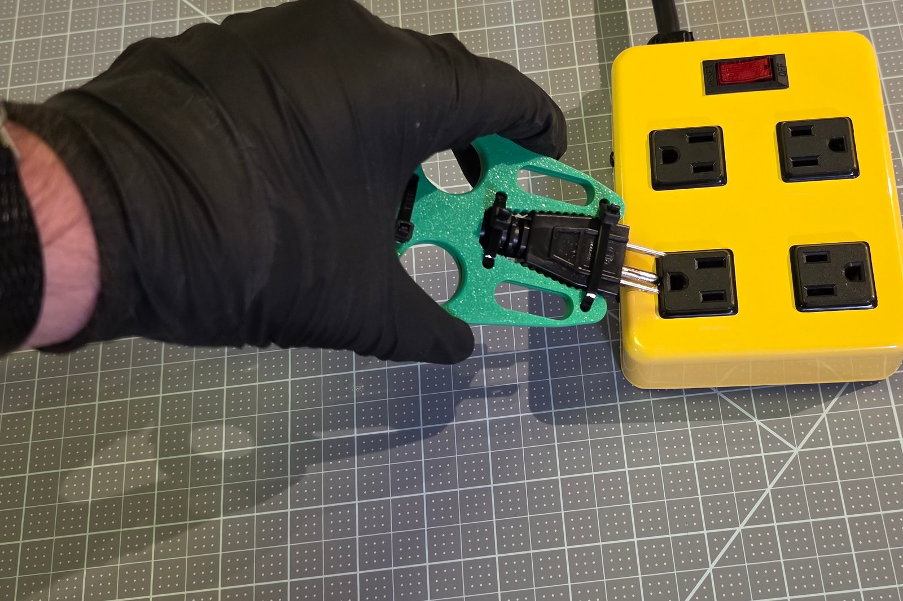
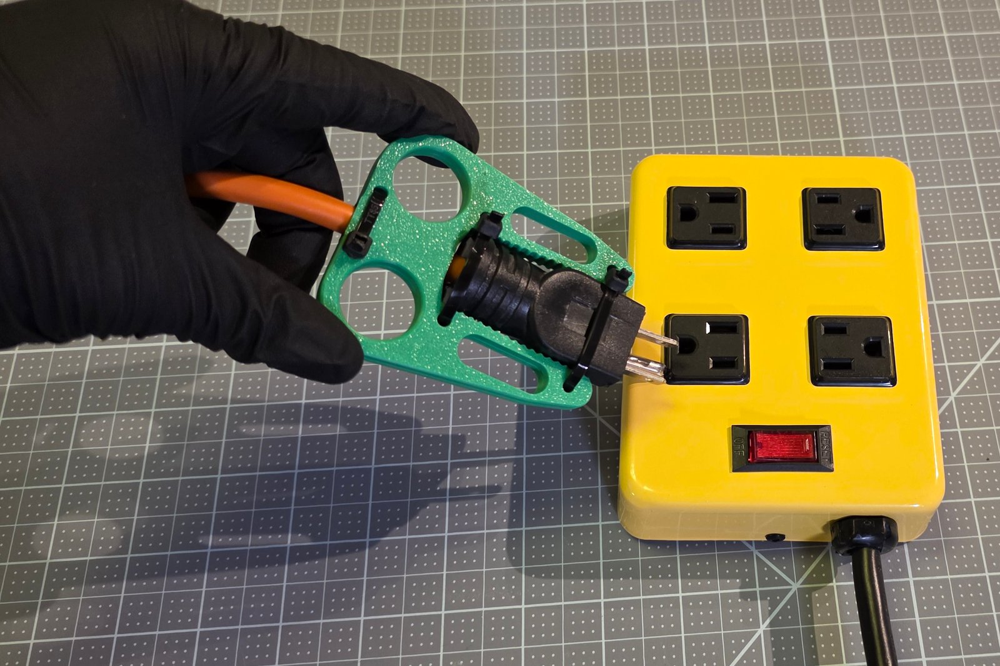

# User Guide

How to pull a plug out of an outlet with a Plug Puller already fitted to it, with the whole hand instead of a fingertip pinch, and what to do when it does not come out cleanly.

## What the Plug Puller is and does

The Plug Puller is a 3D-printed tool for pulling an electrical plug out of an outlet with the whole hand instead of a fingertip pinch: two fingers go through two finger holes and pull straight back, and the tool touches only the plug's sides and back, never the outlet. It comes as two tools, each made for one plug and one hand. The one-sided puller is one flat part with a pocket the plug lies in, for plugs with 2 prongs and USB-C tips. The two-sided puller is two flat plates zip-tied face to face around the plug, for plugs with 3 prongs. Either one stays on its plug, so there is nothing to put on before a pull.

The pull: two fingers through the finger holes, and a straight pull away from the outlet.

## How this guide names directions

Stand or sit facing the outlet with the plug in it. Toward the outlet is in; away from the outlet is out. The finger holes are at the end of the tool farthest from the outlet, where the cord leaves the plug, and the plug's prongs are at the end nearest the outlet.

## Pull the plug

### Step 1: Find the finger holes

Find the two round finger holes at the end of the tool away from the outlet, one each side of the cord.

**By touch:** the finger holes are the two largest openings, each wider than a finger, with smooth rounded rims; the cord runs out between them.

### Step 2: Put two fingers through

Put two fingers through the holes, one in each, from the side that suits your hand; the index and middle fingers are a common choice.

### Step 3: Pull straight out

Pull straight back, away from the outlet, keeping the tool square to it. The plug comes out with the tool.

**Careful:** never lever the tool sideways or up and down, and keep your fingers on the tool, away from the prongs, as the plug comes out.

The heavy-duty plug just before the pull: the fingers are in the holes and the tool is square to the outlet.

### Step 4: Plug it back in

Push the plug back in by the tool's body, prongs lined up with the outlet's slots. The tool stays on the plug for the next pull.

## Safety

- Nothing goes between the plug face and the outlet cover: the tool grips only the plug's sides and back.
- Pull straight out. Never lever the tool sideways or up and down.
- Do not use the tool on a damaged cord, a cracked plug, or a plug that is warm to the touch.
- The tool has no conductive parts, but it is plastic near electricity: if it cracks, stop using it and print a new one.

## A different plug or a different hand

A Plug Puller is made for one plug and one hand. For another plug, or another person's hand, a new tool is made in a customizer: the [Maker Guide](Step_2_Guide_Option_3_Plug_Puller_Maker_Guide.md) says how, starting with the prong count, which picks the tool.

## If the pull does not go well

| What happens | What to do |
|---|---|
| The plug slides out of the tool instead of out of the outlet | Pull the zip ties a little tighter, or replace a loose one; the full guide's fit table has more |
| A 3-prong plug keeps slipping out of a one-sided puller | Make a two-sided puller for it: 3-prong plugs belong to that tool |
| A 2-prong plug or a USB-C tip keeps slipping out of a two-sided puller | Make a one-sided puller for it: those plugs belong to that tool |
| Fingers pinch or swim in the holes | Make the tool again one hand size up or down, or with Measure my hand |
| A crack in a finger hole or where a tie passes | Stop using the tool and print a new one |

Each tool's full guide has the full fit table: [one-sided puller](../docs/guides/one-sided/full-guide.md#if-the-print-does-not-fit), [two-sided puller](../docs/guides/two-sided/full-guide.md#if-the-print-does-not-fit).
