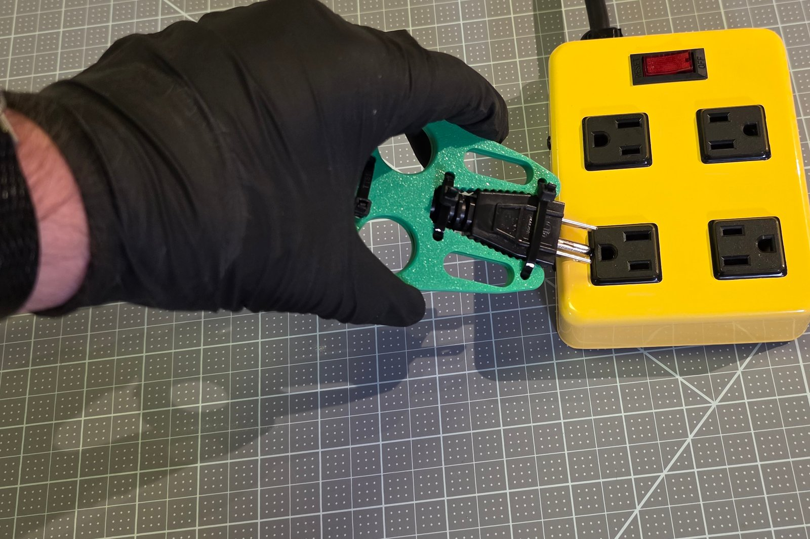

<!--- Open Source Assistive Technology: GitHub Readme based on OpenAT-Template v1.2 (2025-Feb-04). Original template: https://github.com/makersmakingchange/OpenAT-Template --->

# Plug Puller, Version 1.0

## Overview

The **Plug Puller** is a 3D-printed tool for pulling an electrical plug out of an outlet with the whole hand instead of a fingertip pinch: two fingers go through two finger holes and pull straight back, and the tool touches only the plug's sides and back, never the outlet. It is for anyone who cannot grip a plug and pull it: arthritis, low grip strength, tremor, a small hand, one hand. It is a parametric OpenSCAD model: pick a preset or measure the plug and the hand, fill in a form, export, print.

It comes as **two tools, each its own file**. Count the plug's prongs:

- **2 prongs, or a USB-C tip: the one-sided puller**, [`src/Plug_Puller_Parametric.scad`](src/Plug_Puller_Parametric.scad) (as one file, [`dist/Plug_Puller_One_Sided_SingleFile.scad`](dist/Plug_Puller_One_Sided_SingleFile.scad)): one printed part with a pocket the plug lies in, two finger holes, a cord hook, and zip-tie holes or strap openings. Presets: USB-C laptop tip, flat 2-prong lamp plug, wide 2-prong appliance plug.
- **3 prongs, or any plug 24 mm thick or more: the two-sided puller**, [`src/Plug_Puller_Two_Sided.scad`](src/Plug_Puller_Two_Sided.scad) (as one file, [`dist/Plug_Puller_Two_Sided_SingleFile.scad`](dist/Plug_Puller_Two_Sided_SingleFile.scad)): two identical toothed plates zip-tied face to face around the plug. Presets: standard 3-prong plug, heavy-duty extension cord.

No setting inside one file makes the other tool, as a setting did in older versions: to get the other tool, open its file. The split follows test prints; the [Design Rationale](Documentation/Plug_Puller_Design_Rationale.md) has the details. The USB-C laptop tip preset is new in 1.0 and not yet test-printed.

## Makers Making Change Assistive Device Library

- <MMCWebLink>

## How to Obtain the Device

### 1. Do-it-Yourself (DIY) or Do-it-Together (DIT)

This is an open-source assistive technology, so anyone is free to build it. All of the files and instructions required to build the device are in this repository: a 3D printer, a little filament, two or three zip ties, and a customizer, in the browser, on the desktop or on MakerWorld.

- **Customize in your browser**, nothing to install: the [OpenSCAD Assistive Forge](https://openscad-assistive-forge.pages.dev/), a browser version of OpenSCAD built for keyboard and screen reader use, opens each tool from one link: **[the one-sided puller](https://openscad-assistive-forge.pages.dev/?manifest=https://raw.githubusercontent.com/BrennenJohnston/openscad-assistive-forge/example-manifest/plug-puller/forge-manifest-one-sided.json)** or **[the two-sided puller](https://openscad-assistive-forge.pages.dev/?manifest=https://raw.githubusercontent.com/BrennenJohnston/openscad-assistive-forge/example-manifest/plug-puller/forge-manifest-two-sided.json)**. The [Browser Customizer Guide](Documentation/Step_1_Guide_Option_1_Plug_Puller_Browser_Customizer_Guide.md) walks through it.
- **Customize on your computer** in the free OpenSCAD desktop program: the [OpenSCAD Guide](Documentation/Step_1_Guide_Option_2_Plug_Puller_OpenSCAD_Guide.md).
- **Customize on MakerWorld**: the [MakerWorld Guide](Documentation/Step_1_Guide_Option_3_Plug_Puller_MakerWorld_Guide.md).
- **Download a ready-made STL**: [`stl/Plug-Puller/`](stl/Plug-Puller) holds every preset at Small, Medium and Large hand sizes, 15 tools, listed in [`stl/README.md`](stl/README.md).

Not sure which preset? Print the [plug size finder](docs/guides/plug-size-finder.svg) at 100 %, check its 50 mm square, and lay the plug on the outlines. Each tool's quick start has the measuring form for a plug that matches none.

### 2. Request a build of this device

You may also submit a build request through the [Makers Making Change Assistive Device Library Listing](<MMCWebLink>) to have a volunteer maker build the device. As the requestor, you are responsible for reimbursing the maker for the cost of materials and any shipping.

### 3. Build this device for someone else

If you have the skills and equipment to build this device, and would like to donate your time to create the device for someone who needs it, visit the [MMC Maker Wanted](https://makersmakingchange.com/maker-wanted/) section.

## Build Instructions

### 1. Make the tool for the plug and the hand

The printed tool is the custom part: count the prongs to pick the tool, then pick a preset or type the plug's numbers and the hand size in a customizer. The Step 1 guides cover the [browser](Documentation/Step_1_Guide_Option_1_Plug_Puller_Browser_Customizer_Guide.md), the [desktop](Documentation/Step_1_Guide_Option_2_Plug_Puller_OpenSCAD_Guide.md) and [MakerWorld](Documentation/Step_1_Guide_Option_3_Plug_Puller_MakerWorld_Guide.md); each tool's quick start and full guide explain every setting with a picture ([one-sided quick start](docs/guides/one-sided/quick-start.md), [one-sided full guide](docs/guides/one-sided/full-guide.md), [two-sided quick start](docs/guides/two-sided/quick-start.md), [two-sided full guide](docs/guides/two-sided/full-guide.md)).

### 2. Print it

Flat on the bed as the file comes, no supports, 0.2 mm layers, 3 to 4 walls, 25 to 35 % infill, PETG or PLA. The [Maker Guide](Documentation/Step_2_Guide_Option_3_Plug_Puller_Maker_Guide.md) has the print table; the [bill of materials](Documentation/Plug_Puller_BOM.csv) lists the filament and the zip ties.

### 3. Assemble the device

The [Maker Guide](Documentation/Step_2_Guide_Option_3_Plug_Puller_Maker_Guide.md) walks through it in a few pages. The [Assembly Guide By Touch](Documentation/Step_2_Guide_Option_2_Plug_Puller_Assembly_Guide_By_Touch.md) says every step for the hands, and the [Visual Assembly Guide](Documentation/Step_2_Guide_Option_1_Plug_Puller_Visual_Assembly_Guide.md) shows it without words. The [User Guide](Documentation/Step_3_Guide_Plug_Puller_User_Guide.md) teaches the pull. Each is also printed as a tagged PDF.

## How to Improve this Device

As open-source assistive technology, you are welcomed and encouraged to improve upon the design. The model is built to be changed and checked; its data files, tests and scripts are all here.

- **The Customizer schemas:** [`parameter_mapping.json`](parameter_mapping.json) (one-sided, 79 parameters) and [`parameter_mapping_two_sided.json`](parameter_mapping_two_sided.json) (two-sided, 40 parameters) list every name, type, range, step and default; [`dial_catalog.json`](dial_catalog.json) holds every dial's title, sentence and diagram settings, and the diagrams are under [`docs/dials/`](docs/dials/README.md).
- **The engineering reference:** [`docs/Plug_Puller_Reference.md`](docs/Plug_Puller_Reference.md) (both tools, coordinate frames, the plug side rail, the plate geometry, CSG order, sizes, the derivation layer, render modes, validation warnings) and the [Design Rationale](Documentation/Plug_Puller_Design_Rationale.md) (why each default is what it is).
- **The scripts:** [`scripts/README.md`](scripts/README.md) lists every build and check script (the release library, the outline sheets, the plug size finder, the PDFs, the dial diagrams, the docs gate).
- **The tests:** `python -m pytest -m "not requires_openscad" -p no:cacheprovider` runs the quick lane; the render lane (`-m requires_openscad`) needs the OpenSCAD 2026.01.03 nightly; CI runs both.
- **Publishing to MakerWorld:** its Parametric Model Maker runs one OpenSCAD file without `include` files, so upload the single-file builds in `dist/`, each as its own customizable file, and test them first in the Creator Portal. The listing is [`Documentation/Plug_Puller_MakerWorld_Listing.md`](Documentation/Plug_Puller_MakerWorld_Listing.md), its pictures are in [`MakerWorld_Photos/`](MakerWorld_Photos/README.md). MakerWorld downloads use CC BY-NC-SA 4.0, the listing license closest to this repository's PolyForm Noncommercial 1.0.0; the maintainer publishes from their own account.
- **Other regions' plugs:** the presets are US (NEMA) plugs; the measured path may suit others, untested.

### Features

Both tools:

- **Two tools, two files, split by the prong count.** They share one size table (`src/fit_sizes.scad`); a plug 24 mm thick or more gets a red tag in the one-sided file that points to the two-sided file.
- **Measurement-first Customizer.** Plug measurements are Step 1, named for where you take them: the **prong end** and the **cord end**; sizes and attachment are one dropdown each.
- **Plug presets.** `plug_preset` fills in a measured plug: the USB-C laptop tip, the lamp plug and the wide appliance plug in the one-sided file; the standard 3-prong plug and the heavy-duty extension cord in the two-sided file. `Measure my plug` keeps the sliders authoritative.
- **See-through plug.** The preview draws a translucent plug built from your numbers (`show_plug_preview`, on by default), so you can check the fit before printing; it is never exported.
- **In-model validation.** A red warning tag is printed flat on the bed next to the part when a check trips (one-sided W-1 to W-20; two-sided WC-1 to WC-13), naming the measurement to fix.
- **Try-before-you-print.** The [plug size finder](docs/guides/plug-size-finder.svg), 1:1 [outline sheets](docs/Plug_Puller_Outline_Sheets.pdf) for every preset and size, and the printable [measuring stencil](Measuring_Stencil.scad).

The one-sided puller:

- **Plug side rail.** The pocket walls, zip stations, and velcro slot follow one rail down the plug's side; its taper comes from the two width stations over the plug length.
- **Organic body.** A fitted octagon with side rounding: a crisp plug end, a rounded cord end, wider shoulder ears.
- **Dome plug pocket.** A plug-shaped recess plus a deeper circular seat centered on the top edge.
- **Finger holes.** A mirrored pair, Ø 25.4 mm at Medium, with rounded rims.
- **Cord J-hook.** An offset stem and a catch lip, so a hooked cord cannot back out (`hook_hand` mirrors it).
- **Plug wall notch.** A notch that straddles the outlet cover plate; its depth follows the wall-plate style, and the USB-C preset takes No plate / flush.
- **Zip-tie holes and wing openings.** A 2×2 grid of Ø 5.08 mm holes, and curved wing openings for a strap, checked against `strap_width`.
- **Auto-fit.** Every feature is bounds-clamped against the body, and each clamp is reported in the console.

The two-sided puller:

- **Two identical plates.** `print_layout = Both plates` (the default) puts both side by side in one file.
- **A head station.** The gap between the arms keeps the plug's prong-end width along its head, then follows the plug's taper to the cord end.
- **Rounded or flat sides.** `plug_sides`: `Rounded sides` gives each plate a sloped cradle that centers a round plug; `Flat sides`, which both presets use, keeps the edge straight so the teeth bite along the whole side.
- **Serrated grip, cord channel, finger holes.** Teeth along both arms, a channel for the cord, finger holes of Ø 17.5 / 21 / 24 mm at Small / Medium / Large.
- **Zip-tie stations and strap slots.** Three tie stations per arm, and a strap slot in each arm when the plug is long enough.
- **Plate dials.** `Advanced - Two-Sided Puller`: 26 `plate_*` dials, led by `plate_wall_boost`, which thickens every wall at once.

### Sizes

Both files read the same Small / Medium / Large finger widths from [`src/fit_sizes.scad`](src/fit_sizes.scad). In the one-sided puller every non-Custom size routes through the measurement derivation layer ([`src/fit_measured.scad`](src/fit_measured.scad)): the plug numbers drive the pocket, notch and hook, and the size picks the hand pair that drives the grip and the body. The pairs come from ANSUR II (2012) hand breadth and Rogers (2008) knuckle breadth: Small ≈ 5th-percentile female hand, Large ≈ 95th-percentile male hand.

| Size | Hand pair (finger / hand) | Body | Notes |
| ---- | ------------------------- | ---- | ----- |
| `Small` | 16.5 / 72 mm | ≈ 60 × 65 × 5.4 mm | scaled-down grip |
| `Medium` | 20 / 85 mm | 81.55 × 65.5 × 6.35 mm | the reference device |
| `Large` | 23 / 96 mm | ≈ 78 × 66 × 7.2 mm | scaled-up grip |
| `Measure my hand` | your two measurements | derived | defaults reproduce Medium exactly |
| `Custom` | none | sliders | measurements ignored; every slider unlocked |

The two-sided puller uses the finger width only, and has no `Custom` size.

### Saved Customizer parameter sets

[`presets/Plug_Puller_Parametric.json`](presets/Plug_Puller_Parametric.json) ships example sets for the one-sided puller:

| Name in JSON | Loads as | Notes |
| ------------ | -------- | ----- |
| `Medium (v6 reference)` | `Medium` | the reference device, zip ties + wing velcro |
| `USB-C laptop tip` | `plug_preset` | 17 mm long, 10.25 wide, 6.5 thick (estimated), 6.1 mm cord, No plate / flush |
| `Flat 2-prong lamp plug (NEMA 1-15)` | `plug_preset` | 32.5 mm long, width 20 → 11.1, thickness 18.6 → 8.6 (estimated), 3.6 mm cord |
| `Wide 2-prong appliance plug - NEMA 1-15` | `plug_preset` | 38 mm long, 34 wide and 16 thick at both ends, 5 mm cord |
| `Small hands` / `Large hands` | `Small` / `Large` | ANSUR II grip scaling |
| `Measure my plug + hand (US vacuum plug)` | `Measure my hand` | the same plug typed by hand, Decora plate, 22 / 88 mm hand |
| `Left-handed + classic velcro slots` | `Medium` | `hook_hand = Left`, `velcro_style = Classic slot` |

[`presets/Plug_Puller_Two_Sided.json`](presets/Plug_Puller_Two_Sided.json) ships `Round extension cord - NEMA 5-15` and `Standard 3-prong plug - NEMA 5-15`, each its preset at Medium.

### Render modes

The hidden `render_mode` parameter picks which geometry is built. In the one-sided file: `Full` (the tool with its cutouts and warnings), `Body Only`, `Body No Cutouts`, one `Only …` mode per feature, and `Cutouts Only 2D`. In the two-sided file, `Full` builds what Step 4's `print_layout` picks and `One plate` always builds one plate.

### Troubleshooting

| Symptom | Likely cause | Where to look |
| ------- | ------------ | ------------- |
| Red warning tag beside the model | A validation check tripped | The tag names the measurement to fix; see Red warning tags in the [one-sided](docs/guides/one-sided/full-guide.md#red-warning-tags) or [two-sided](docs/guides/two-sided/full-guide.md#red-warning-tags) full guide |
| Red tag `PLUG THICKER THAN 24MM - USE THE TWO-SIDED PULLER FILE` | Too thick for the one-sided pocket | Open [`src/Plug_Puller_Two_Sided.scad`](src/Plug_Puller_Two_Sided.scad) and fill in its Step 1 |
| A 3-prong plug slips out of a one-sided puller | 3-prong plugs belong to the two-sided puller | Make a two-sided puller for it |
| A 2-prong plug or USB-C tip slips out of a two-sided puller | Those plugs belong to the one-sided puller | Make a one-sided puller for it |
| Orange `STRAP SLOT LEFT OUT - PLUG TOO SHORT FOR ONE` | Too short a plug for a strap slot; the ties still hold | Nothing to fix; or pick `Zip ties` in Step 3 |
| Typed measurements but the model does not change | `size` is `Custom`, which ignores measurements | Pick another size in Step 2 |
| Hand sliders do nothing | They apply only when `size = Measure my hand` | Step 2 of the Customizer |

## Files

### Documentation

| Document | Version | Link |
|---|---|---|
| Step 1, option 1: Browser customizer guide | 1.0 | [Markdown](Documentation/Step_1_Guide_Option_1_Plug_Puller_Browser_Customizer_Guide.md), [PDF](Documentation/Step_1_Guide_Option_1_Plug_Puller_Browser_Customizer_Guide.pdf) |
| Step 1, option 2: OpenSCAD guide | 1.0 | [Markdown](Documentation/Step_1_Guide_Option_2_Plug_Puller_OpenSCAD_Guide.md), [PDF](Documentation/Step_1_Guide_Option_2_Plug_Puller_OpenSCAD_Guide.pdf) |
| Step 1, option 3: MakerWorld guide | 1.0 | [Markdown](Documentation/Step_1_Guide_Option_3_Plug_Puller_MakerWorld_Guide.md), [PDF](Documentation/Step_1_Guide_Option_3_Plug_Puller_MakerWorld_Guide.pdf) |
| Step 2, option 1: Visual assembly guide | 1.0 | [Markdown](Documentation/Step_2_Guide_Option_1_Plug_Puller_Visual_Assembly_Guide.md), [PDF](Documentation/Step_2_Guide_Option_1_Plug_Puller_Visual_Assembly_Guide.pdf) |
| Step 2, option 2: Assembly guide by touch | 1.0 | [Markdown](Documentation/Step_2_Guide_Option_2_Plug_Puller_Assembly_Guide_By_Touch.md), [PDF](Documentation/Step_2_Guide_Option_2_Plug_Puller_Assembly_Guide_By_Touch.pdf) |
| Step 2, option 3: Maker guide | 1.0 | [Markdown](Documentation/Step_2_Guide_Option_3_Plug_Puller_Maker_Guide.md), [PDF](Documentation/Step_2_Guide_Option_3_Plug_Puller_Maker_Guide.pdf) |
| Step 3: User guide | 1.0 | [Markdown](Documentation/Step_3_Guide_Plug_Puller_User_Guide.md), [PDF](Documentation/Step_3_Guide_Plug_Puller_User_Guide.pdf) |
| Bill of materials | 1.0 | [CSV](Documentation/Plug_Puller_BOM.csv) |
| Device summary | 1.0 | [Markdown](Documentation/Plug_Puller_Device_Summary.md), [PDF](Documentation/Plug_Puller_Device_Summary.pdf) |
| Design rationale | 1.0 | [Markdown](Documentation/Plug_Puller_Design_Rationale.md), [PDF](Documentation/Plug_Puller_Design_Rationale.pdf) |
| Documentation checklist | 1.0 | [Markdown](Documentation/COMPLIANCE_CHECKLIST.md): the seventeen Makers Making Change items |
| Change log | 1.0 | [CHANGES.txt](CHANGES.txt); the full history is [CHANGELOG.md](CHANGELOG.md) |

How the documents are written and checked is in [`Documentation/README.md`](Documentation/README.md); the record of decisions and open questions is in [`NOTES/`](NOTES/00_DECISION_LOG.md).

Each tool also has its own quick start and full guide, as pages and printable PDFs, with the plug size finder, the measuring form and the paper stencil sheet at true size as their last pages:

| Tool | Quick start | Full guide |
| ---- | ----------- | ---------- |
| One-sided puller | [page](docs/guides/one-sided/quick-start.md), [PDF](docs/Plug_Puller_One_Sided_Quick_Start.pdf) | [page](docs/guides/one-sided/full-guide.md), [PDF](docs/Plug_Puller_One_Sided_Full_Guide.pdf) |
| Two-sided puller | [page](docs/guides/two-sided/quick-start.md), [PDF](docs/Plug_Puller_Two_Sided_Quick_Start.pdf) | [page](docs/guides/two-sided/full-guide.md), [PDF](docs/Plug_Puller_Two_Sided_Full_Guide.pdf) |

The sheets on their own: the [plug size finder](docs/guides/plug-size-finder.svg), the measuring forms ([one-sided](docs/guides/one-sided/measuring-form.svg), [two-sided](docs/guides/two-sided/measuring-form.svg)), the [paper stencil sheet](docs/guides/stencil-sheet.svg) and every [1:1 outline sheet](docs/Plug_Puller_Outline_Sheets.pdf). The hand-written text of the per-tool guides is in [`docs/guides/source/`](docs/guides/source), one topic per file; edit there, then rebuild.

### Design Files

- [`src/Plug_Puller_Parametric.scad`](src/Plug_Puller_Parametric.scad): the one-sided puller; open this in OpenSCAD.
- [`src/Plug_Puller_Two_Sided.scad`](src/Plug_Puller_Two_Sided.scad): the two-sided puller; open this in OpenSCAD.
- [`src/fit_sizes.scad`](src/fit_sizes.scad), [`src/presets.scad`](src/presets.scad), [`src/fit_measured.scad`](src/fit_measured.scad): the shared size table, the Medium reference table and routing, and the measurement-to-parameter derivations (one-sided).
- [`Measuring_Stencil.scad`](Measuring_Stencil.scad): the printable measuring stencil.
- [`dist/`](dist): the single-file builds of both pullers for MakerWorld and the browser, generated by `scripts/build_flattened.py`.
- [`presets/`](presets): example saved Customizer parameter sets for both files.

OpenSCAD writes no STEP file; the parametric sources are the design files.

### Build Files

- [`stl/`](stl/README.md): the ready-to-print library: `Plug-Puller/` holds 15 tools (every preset of its tool at three hand sizes; both plates per two-sided file), `Measuring-Stencil/` the sizing cards in Visual and Tactile label modes.

### Video Tutorials

No video is published with this release; the written guides stand on their own.

## License

Copyright (c) 2026 Brennen Johnston.

[PolyForm Noncommercial 1.0.0](LICENSE) (also in [`LICENSES/`](LICENSES)): personal, hobby, educational, research, and other noncommercial use is permitted. Contact the maintainer for commercial use. Downloads from MakerWorld are under CC BY-NC-SA 4.0.

## Attribution

The device was designed by Brennen Johnston. The hand sizes come from the ANSUR II (2012) hand breadth survey and Rogers (2008) knuckle breadth. The pipeline conventions (presets, in-model warnings) were adapted from the sibling project [`braille-stl-generator-openscad`](https://github.com/BrennenJohnston/braille-stl-generator-openscad). The documentation is written to the Accessible Open AT Documentation Standard and the [Accessible MakerWorld Documentation Standard](https://github.com/BrennenJohnston/accessible-makerworld-doc-standard/blob/main/ACCESSIBLE_MAKERWORLD_DOC_STANDARD.md).

The project was made possible with support from the [Washington Assistive Technology Act Program (WATAP)](https://watap.org/) and the [University of Washington Center for Research and Education on Accessible Technology and Experiences (UW CREATE)](https://create.uw.edu/).

The documentation template was created by Makers Making Change / Neil Squire Society and is used under a CC BY-SA 4.0 license. It is available at: [https://github.com/makersmakingchange/OpenAT-Template](https://github.com/makersmakingchange/OpenAT-Template)

### Contributors

Designers:
- Brennen Johnston

Testers:
- Brennen Johnston

<!-- ABOUT MMC START -->
## About Makers Making Change

Makers Making Change is a program of [Neil Squire](https://www.neilsquire.ca/), a Canadian non-profit that uses technology, knowledge, and passion to empower people with disabilities.

Makers Making Change leverages the capacity of community based Makers, Disability Professionals and Volunteers to develop and deliver affordable Open Source Assistive Technologies.

 - Website: [www.MakersMakingChange.com](https://www.makersmakingchange.com/)
 - GitHub: [makersmakingchange](https://github.com/makersmakingchange)
 - Bluesky: [@makersmakingchange.bsky.social](https://bsky.app/profile/makersmakingchange.bsky.social)
 - Instagram: [@makersmakingchange](https://www.instagram.com/makersmakingchange)
 - Facebook: [makersmakechange](https://www.facebook.com/makersmakechange)
 - LinkedIn: [Neil Squire Society](https://www.linkedin.com/company/neil-squire-society/)
 - Thingiverse: [makersmakingchange](https://www.thingiverse.com/makersmakingchange/about)
 - Printables: [MakersMakingChange](https://www.printables.com/@MakersMakingChange)

### Contact Us
For technical questions, to get involved, or to share your experience we encourage you to [visit our website](https://www.makersmakingchange.com/) or [contact us](https://www.makersmakingchange.com/s/contact).
<!-- ABOUT MMC END -->
