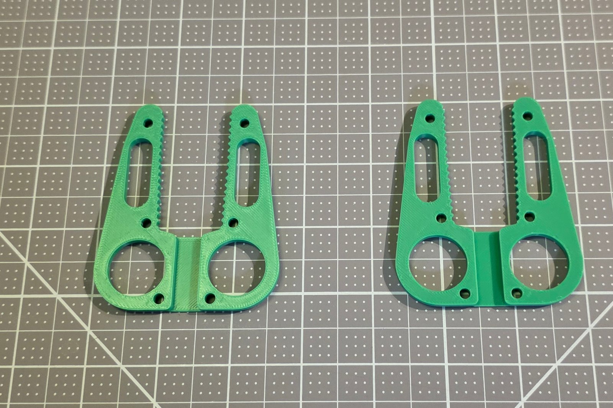
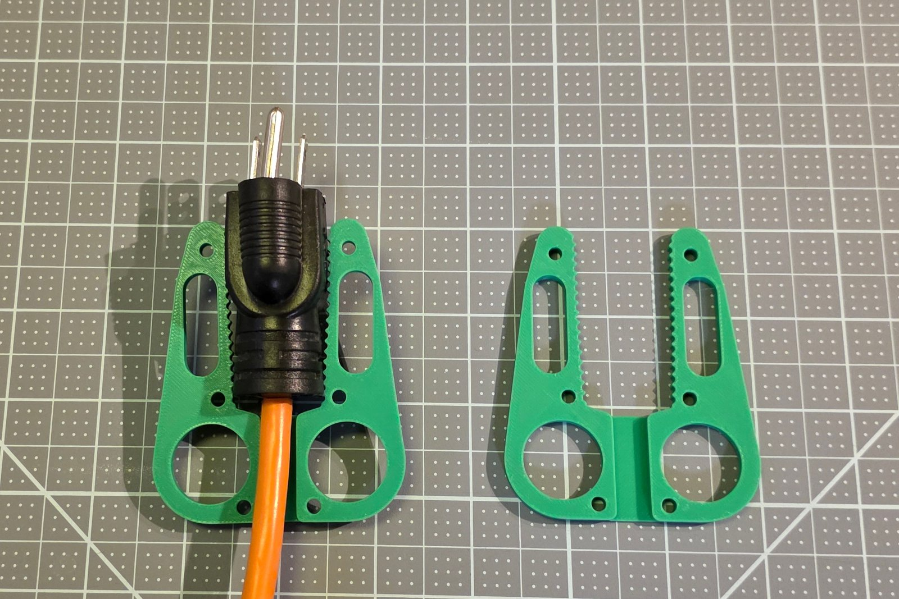
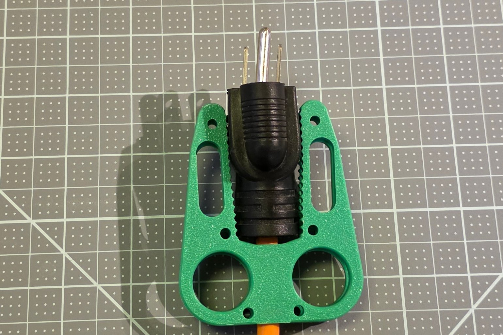
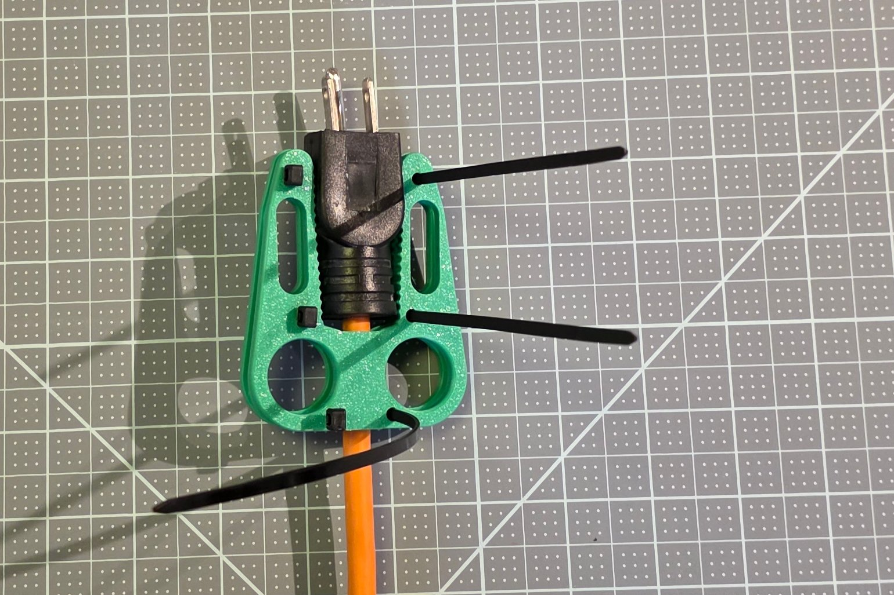
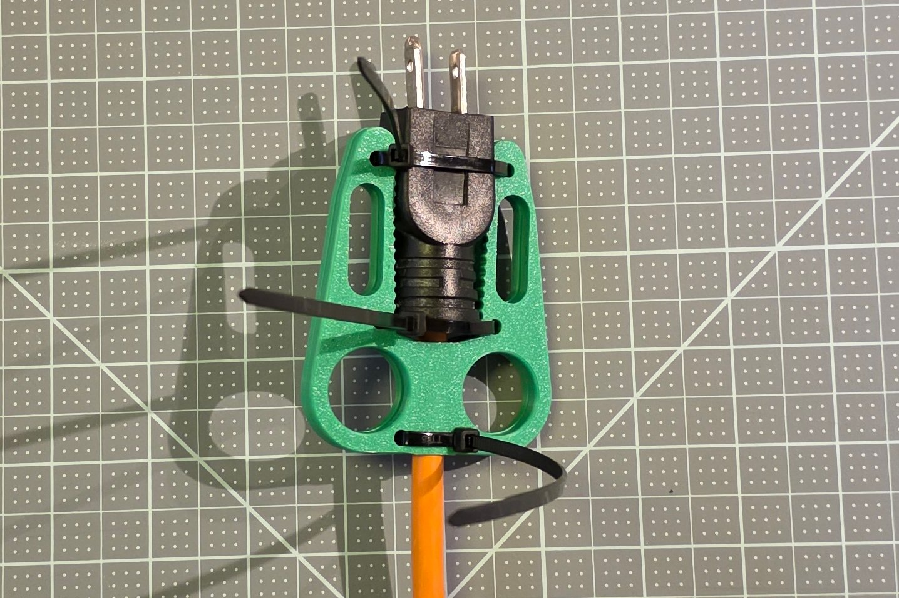

## Assemble

You need three zip ties; the size is in the [bill of materials](../bom.md). The two plates are identical: one lies flat, the plug goes on it, and the other is turned over on top, so the toothed arms close on the plug from both sides.

1. Lay both printed plates flat, their toothed arms pointing away from you.

   

2. Lay the plug on the first plate between its arms: the prongs past the arm tips, the cord in the channel between the finger holes.

   

3. Turn the second plate over and lay it on top, its outline over the first plate's and its finger holes over the first plate's finger holes.

   

4. Thread each zip tie down through a hole on one side of both plates, under the pair, up through the matching holes on the other side, and into its own head, so it crosses over the plug.

   

5. Pull the ties tight, a little at a time on each, until the plug no longer moves between the plates.

   

6. Cut off the zip-tie tails.

   

The tool stays on the plug: the toothed arms do the gripping, and the zip ties hold the two plates together.
