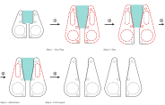
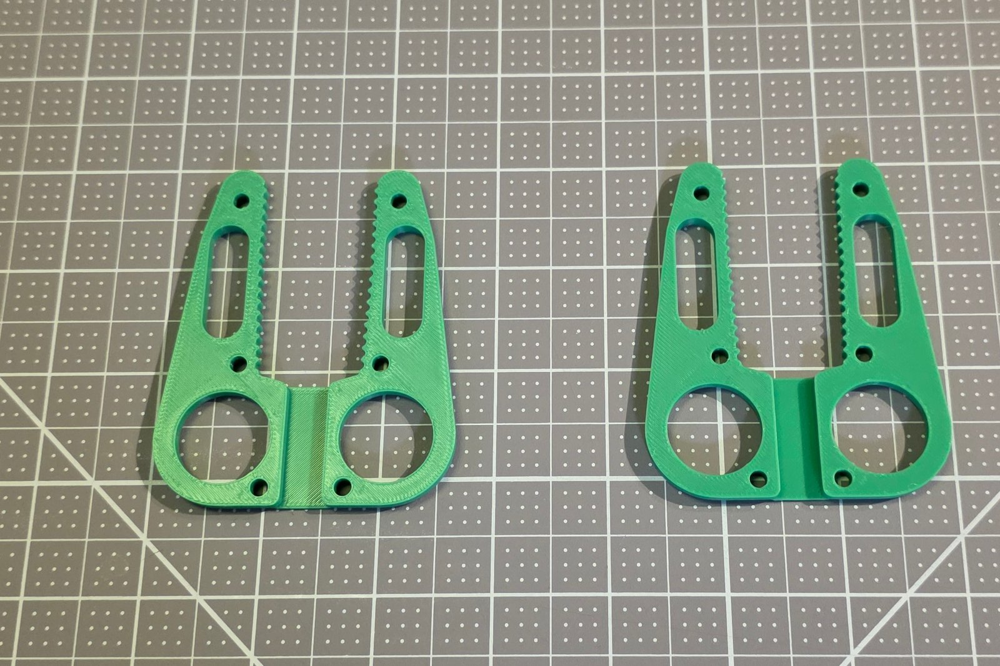
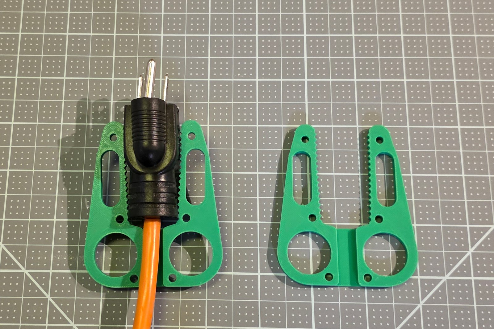
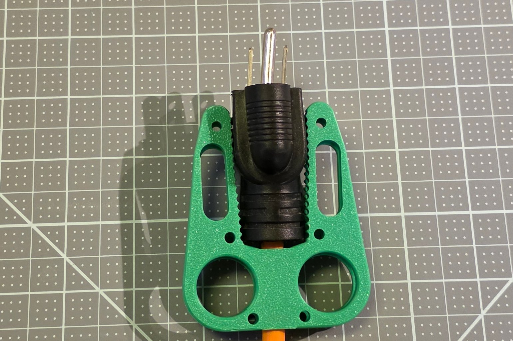
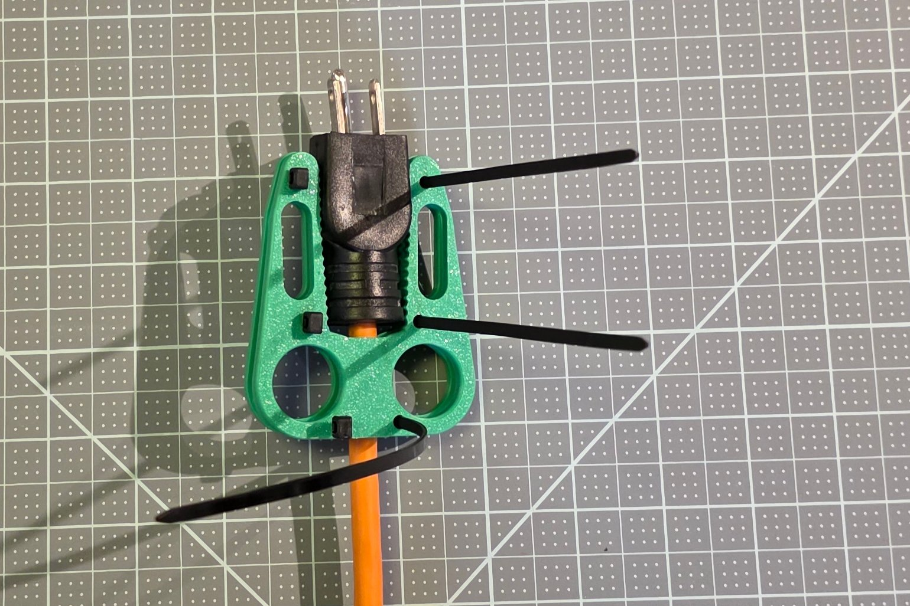
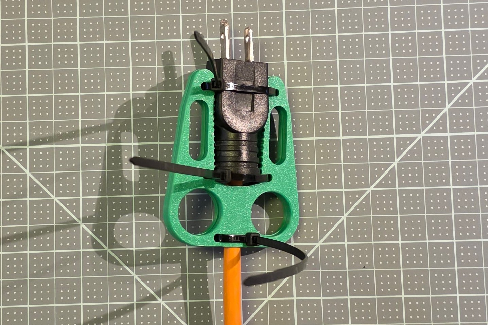
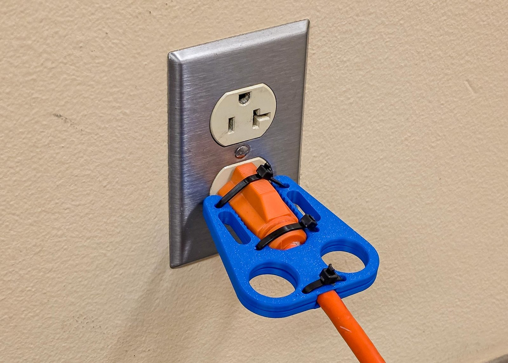
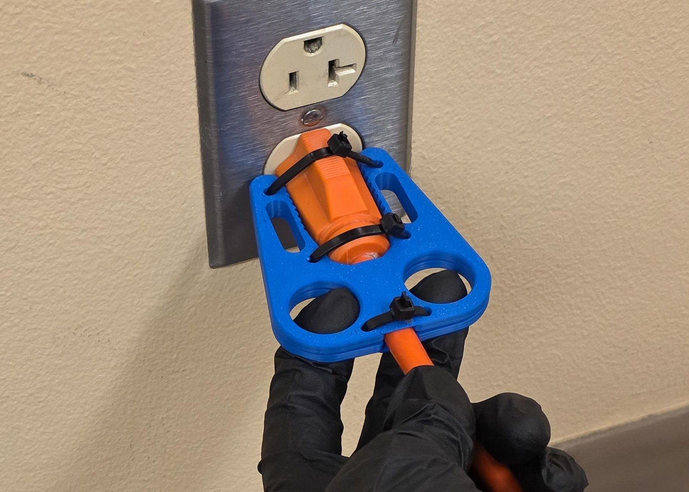

# Quick start, two-sided puller

The shortest path from a stuck plug to a printed two-sided puller that fits it and your hand: get the file, measure, fill in the four Customizer steps, print, assemble, use.

Model version 1.0.0. [The printable quick start](../../Plug_Puller_Two_Sided_Quick_Start.pdf) has the same text, with the measuring form and the paper stencil sheets at true size as its last pages. The other document for this tool is [the full guide](full-guide.md). Each step lists its dials by their plain names, with the name the Customizer shows beside each.

## Which tool this is

This guide is for the two-sided puller, src/Plug_Puller_Two_Sided.scad (as one file, Plug_Puller_Two_Sided_SingleFile.scad): two serrated plates that zip-tie around the plug and close across it, for a plug with 3 prongs and any plug 24 mm thick or more. A plug with 2 prongs or a USB-C tip is the one-sided puller's job: that tool is a separate file, with its own guide.

The Customizer's four steps are your plug, your size, the attachment and the print layout. This quick start covers getting the file, measuring your plug and your hand or matching a card, each step's dials in a table, then printing, assembly and use.

If red text appears beside the part in the preview, read it: it names the measurement to fix, and the part will not fit until it is gone.

In every picture: black = the tool; teal = your plug; red dashed = the edges this dial moved; the numbers match the key beside the picture.

Five stages of the two-sided puller, left to right, the top row first, the plug end at the top; arrows numbered 1 to 4 show the steps, and red dashes mark the edges each step moved. Start, the defaults: the tool as the file opens, with a 20 mm wide plug in teal. Step 1 - Your Plug: plug preset Standard 3-prong plug - NEMA 5-15; red on the arms, the finger lobes, the plate edge, the strap slot and the zip stations. Step 2 - Size: hand size Large; red on the arms, the finger lobes, the strap slot, the teeth and the zip stations. Step 3 - Attachment: attachment Zip ties; red on the arms and the zip stations; the strap slot removed, drawn in red from the old outline. Step 4 - Print Layout: both plates side by side in one file, what you print; nothing marked.

- Step 1: pick your plug's preset
- Step 2: pick your hand size
- Step 3: pick how it attaches
- Step 4: both plates in one file

## Get the file

The two-sided puller is the file `src/Plug_Puller_Two_Sided.scad`. There are two ways to open it and fill in its form: in your web browser with nothing to install, or in the free OpenSCAD program on your computer. Both show the same form, called the Customizer.

**Two tools, two files.** The two-sided puller is for a plug with 3 prongs, or any plug 24 mm thick or more. A plug with 2 prongs or a USB-C tip needs the one-sided puller, which is a separate file, [`src/Plug_Puller_Parametric.scad`](../../../src/Plug_Puller_Parametric.scad) (as one file, [`dist/Plug_Puller_One_Sided_SingleFile.scad`](../../../dist/Plug_Puller_One_Sided_SingleFile.scad)), with its own guide; in your browser it is [the one-sided puller in the Assistive Forge](https://openscad-assistive-forge.pages.dev/?manifest=https://raw.githubusercontent.com/BrennenJohnston/openscad-assistive-forge/example-manifest/plug-puller/forge-manifest-one-sided.json). No setting inside one file makes the other tool, as a setting did in older versions: to get the other tool, open its file.

### In your browser

The OpenSCAD Assistive Forge is a version of OpenSCAD that runs in your browser, on a computer or a phone, built for keyboard and screen reader use. Nothing is uploaded: your numbers stay on your device.

1. Open [the two-sided puller in the Assistive Forge](https://openscad-assistive-forge.pages.dev/?manifest=https://raw.githubusercontent.com/BrennenJohnston/openscad-assistive-forge/example-manifest/plug-puller/forge-manifest-two-sided.json). On a first visit Forge asks which interface you want: choose **Assistive Forge**, then **Download & Continue**, and it downloads its engine once.
2. Forge offers to keep a copy of the project in your browser. Choose **Save My Copy**: the tool is then listed on Forge's main page whenever you come back, no link needed.
3. The form shows the four steps' dials first. The rest sit behind one button, **Show all parameters**.

If the link cannot load, Forge says why and offers **Try again**. You can also download the whole tool as one file, [`dist/Plug_Puller_Two_Sided_SingleFile.scad`](../../../dist/Plug_Puller_Two_Sided_SingleFile.scad), and open it from Forge's main page, under Open or start a project.

### On your computer

OpenSCAD is the free program that turns your numbers into a printable file. You use one panel of it and never touch the code.

1. Download OpenSCAD from <https://openscad.org/downloads.html>: the **Development Snapshot** for your system. This project is tested with the snapshot of 2026-01-03; any recent snapshot works. The regular release works too, only slower.
2. Get the project: on its GitHub page press the green **Code** button, then **Download ZIP**, and unzip it anywhere. Or download only [`dist/Plug_Puller_Two_Sided_SingleFile.scad`](../../../dist/Plug_Puller_Two_Sided_SingleFile.scad), the whole tool in one file.
3. Open `src/Plug_Puller_Two_Sided.scad` (or the single file) in OpenSCAD: double-click it, or use **File ▸ Open**. A wall of code appears in an editor pane. Ignore it; you will not touch it.
4. Show the Customizer, the form you type into: in the **View** menu, make sure **Hide Customizer** is unchecked. In older versions it is **Window ▸ Customizer**.

The form's sections read top to bottom in the order you decide things: **Step 1 - Your Plug**, **Step 2 - Size**, **Step 3 - Attachment**, then **Step 4 - Print Layout**. Everything below Step 4 is optional.

## Measure your plug and your hand

Everything here is in mm: a US plug is about 25 mm wide, so a 1 on your paper means you measured in inches. You need a caliper or a ruler with mm marks, the plug in its outlet, and your own hand only if you pick Measure my hand. Print the measuring form at 100 % and fill it in as you go: the sections below are the form's rows, in the same order, and the card names (R1, C1, F1 / F2) are the cards of the printed measuring stencil, described under Match a card instead of measuring.

The two-sided puller's widths are the size the two plates close across, so measure across the plug the way the plates will grip it. The thickness pair, the wall plate style and the hand width belong to the one-sided puller only.

### Start with the plug size finder

Count the plug's prongs first. A plug with 2 prongs, or a USB-C tip, is the one-sided puller's; a plug with 3 prongs is the two-sided puller's. The two tools are separate files, so a plug of the other kind needs the other tool's file and guide. Then print the plug size finder page at 100 % (actual size), check its 50 mm square with a ruler, and lay the plug flat on the outlines of its group, prongs up. When an outline matches, pick that preset in Step 1 and skip the plug rows below; the hand rows still apply. Between two outlines, or none close? Measure every row. The page is the sheet [plug-size-finder.svg](../plug-size-finder.svg).

The page shows five plugs at true size, each lying on its wide side with its prongs up and every prong face on one dashed line, the cord drawn below each at its true width. The left group, under "2 prongs or a USB-C tip: the ONE-SIDED puller", holds the one-sided puller's presets; the right group, under "3 prongs: the TWO-SIDED puller", the two-sided puller's. Each outline is labelled with the preset to pick. A 50 by 50 mm calibration square sits at the bottom left, the five steps below beside it.

| Preset to pick | Tool file | Prongs | Length (mm) | Width at the prong end (mm) | Width at the cord end (mm) | Cord (mm) |
|---|---|---|---|---|---|---|
| USB-C laptop tip | one-sided puller | USB-C metal tip | 17 | 10.25 | 10.25 | 6.1 (round) |
| Flat 2-prong lamp plug - NEMA 1-15 | one-sided puller | 2 | 32.5 | 20 | 11.1 | 7 (flat, 3.6 thick) |
| Wide 2-prong appliance plug - NEMA 1-15 | one-sided puller | 2 | 38 | 34 | 34 | 5 (round) |
| Standard 3-prong plug - NEMA 5-15 | two-sided puller | 3 | 46.1 | 24.66 | 13.6 | 9.25 (round) |
| Heavy-duty extension cord - NEMA 5-15 | two-sided puller | 3 | 51 | 26.56 | 24.5 | 8.25 (round) |

### Plug length

Customizer name: `measure_plug_length`. Row 2 of the measuring form.

With the plug in the outlet, ruler from the wall plate face to the plug's back face.

Typical: 15 to 55 mm. Example: 46.1 mm.

With the stencil: card R1.

### Plug width at the prong end

Customizer name: `measure_plug_width_prong_end`. Row 3 of the measuring form.

Caliper across the plug body just behind the prongs, the size the two plates close across. On a round plug it is the diameter.

Typical: 10 to 40 mm. Example: 24.66 mm.

With the stencil: card R1.

### Plug head length

Customizer name: `measure_plug_head_length`. Row 4 of the measuring form.

Ruler along the plug from the prong end to where the plug starts to narrow. If it narrows right from the prong end, type 0.

Typical: 0 to 25 mm. Example: 15.6 mm.

With the stencil: card R1.

### Plug width at the cord end

Customizer name: `measure_plug_width_cord_end`. Row 5 of the measuring form.

The same direction across the plates, measured at the plug's back end where the cord comes out. A rubber strain relief counts as part of the plug.

Typical: 10 to 40 mm. Example: 13.6 mm.

With the stencil: card R1.

### Cord thickness

Customizer name: `measure_cord_thickness`. Row 6 of the measuring form.

Caliper across the cord just behind the plug, the way the widths run: a flat cord's wide side, a round cord's diameter. On the stencil, it is the smallest C1 slot that takes the cord's wide side.

Typical: 3 to 10 mm. Example: 9.25 mm.

With the stencil: card C1.

### Plug sides

Customizer name: `plug_sides`. Row 7 of the measuring form.

Look at the plug body where the plates will grip it. Rounded sides for a round plug body; Flat sides for a boxy plug.

The choices: Rounded sides, Flat sides.

### Finger width

Customizer name: `measure_finger_width`. Row 10 of the measuring form.

Caliper across the widest knuckle of your middle finger, the finger that goes into the pull hole. With the stencil, find the smallest F1 or F2 hole your finger passes through comfortably and subtract 5 from its number.

Typical: 16 to 24 mm. Example: 22 mm.

With the stencil: card F1 / F2.

No caliper? Take a ring that fits that finger snugly, measure the ring's inner diameter in mm and add 1.5 mm.

### Strap width

Customizer name: `strap_width`. Row 12 of the measuring form.

Read the width on the strap's packaging. ONE-WRAP comes in 10, 13, 16, 20 and 25 mm.

Typical: 10 to 25 mm. Example: 15 mm.

Sanity check: each plug width is a two-digit number, roughly 12 to 45, and the prong-end width is usually the bigger one; the finger width is roughly 14 to 32. A number like 1.3 is inches: measure again with the mm side.

When you measure for someone else, a relative or a client, measure their hand for the finger and hand rows and their outlet and plug for the plug rows. Doubtful between two values? Round up: a slightly roomy fit works, a tight one does not.

### The measuring form

The form is the sheet [measuring-form.svg](measuring-form.svg); the paper stencil sheet is [stencil-sheet.svg](../stencil-sheet.svg). Print the form at 100 % (actual size, never fit to page) and check its 50 mm bar with a ruler before you trust it. Fill in the blanks top to bottom as you measure, then type the numbers into the Customizer in the same order.

**Start here.** Two tick boxes ask how many prongs the plug has: "3 prongs: this form" or "2 prongs or USB-C tip: one-sided form". Then a blank: "Closest outline on the plug size finder:" Lay the plug on the plug size finder page; when an outline in this tool's group matches, write its preset there, tick that preset in row 1 and skip the plug numbers. Otherwise fill in every row.

| # | Customizer name | What you measure | Default | Yours |
|---|---|---|---|---|
| 1 | `plug_preset` | Plug preset: pick one | Measure my plug | ________ |
| 2 | `measure_plug_length` | With the plug in the outlet, ruler from the wall plate face to the plug's back face. | 25.5 mm | ________ |
| 3 | `measure_plug_width_prong_end` | Caliper across the plug body just behind the prongs, the size the two plates close across. | 20 mm | ________ |
| 4 | `measure_plug_head_length` | Ruler along the plug from the prong end to where the plug starts to narrow. | 0 mm | ________ |
| 5 | `measure_plug_width_cord_end` | The same direction across the plates, measured at the plug's back end where the cord comes out. | 20 mm | ________ |
| 6 | `measure_cord_thickness` | Caliper across the cord just behind the plug, the way the widths run: a flat cord's wide side, a round cord's diameter. | 4 mm | ________ |
| 7 | `plug_sides` | Look at the plug body where the plates will grip it. | Rounded sides | ________ |
| 8 | `show_plug_preview` | Show the see-through plug: leave on | on | ________ |
| 9 | `size` | Hand size: pick one | Medium | ________ |
| 10 | `measure_finger_width` | Caliper across the widest knuckle of your middle finger, the finger that goes into the pull hole. | 20 mm | ________ |
| 11 | `attachment` | Attachment: pick one | Zip ties + Velcro strap | ________ |
| 12 | `strap_width` | Read the width on the strap's packaging. | 15 mm | ________ |
| 13 | `print_layout` | Print layout: pick one | Both plates | ________ |

**What the sheet shows.** Under the title, the Start here box holds the two prong tick boxes and the finder blank. Below it, the left column is the numbered list above, one row per dial in the Customizer's Step order, each with the dial's name, its plain title and either a blank after the default or a tick box per choice with the default marked. The right half is a schematic plug in teal at 1.5 to 1, as long and as wide at the prong end as the two-sided puller's defaults: a top view with the prong end at the left against a wall plate line, the plug keeping its full width along its head and then narrowing toward the cord end, the cord's end as a small circle, a bar of four knuckles at 1:1 and a strap bar at 1:1. A straight black arrow runs from each measured row's blank to a red dimension line on the schematic, the row's number in a red circle at the line:

- Arrow 2 points to the plug's length on the top view, from the wall plate to the plug's back end.
- Arrow 3 points to the plug's width at the prong end, the left edge of the top view.
- Arrow 4 points to the plug's head on the top view, from the wall plate to where the plug starts to narrow.
- Arrow 5 points to the plug's width at the cord end, the right edge of the top view where the cord leaves.
- Arrow 6 points to the cord's thickness on the small circle, the cord seen end on.
- Arrow 10 points to one knuckle of the knuckle bar, drawn 20 mm wide at 1:1.
- Arrow 12 points to the strap bar's width, a 40 by 15 mm bar at 1:1.

- Row 1, plug preset: 3 boxes, Measure my plug marked as the default; the choices are Measure my plug, Standard 3-prong plug - NEMA 5-15, Heavy-duty extension cord - NEMA 5-15.
- Row 7, plug sides: 2 boxes, Rounded sides marked as the default; the choices are Rounded sides, Flat sides.
- Row 8, show the see-through plug: one box marked, leave on.
- Row 9, hand size: 4 boxes, Medium marked as the default; the choices are Small, Medium, Large, Measure my hand.
- Row 11, attachment: 2 boxes, Zip ties + Velcro strap marked as the default; the choices are Zip ties + Velcro strap, Zip ties.
- Row 13, print layout: 2 boxes, Both plates marked as the default; the choices are Both plates, One plate.

Type them into the Customizer in this order.

### Match a card instead of measuring

The measuring stencil is a set of thin printed cards. Each has a two-letter name raised on its face, so you can find it by touch. Hold your plug in the plug cards: if it fills one card's openings, snug with no big gaps, that card names the preset to pick in Step 1, and the tool whose file holds it, and you type no numbers at all.

| Card | What it is | What it answers |
| ---- | ---------- | --------------- |
| P1 | The flat 2-prong lamp plug (NEMA 1-15) | the one-sided puller's preset `Flat 2-prong lamp plug - NEMA 1-15` |
| P2 | The standard 3-prong plug (NEMA 5-15) | the two-sided puller's preset `Standard 3-prong plug - NEMA 5-15` |
| P3 | The heavy-duty extension cord plug (NEMA 5-15) | the two-sided puller's preset `Heavy-duty extension cord - NEMA 5-15` |
| P4 | The wide 2-prong appliance plug (NEMA 1-15) | the one-sided puller's preset `Wide 2-prong appliance plug - NEMA 1-15` |
| R1 | A ruler: raised mm ticks, numbers every 10 mm, and a notch every 10 mm you can count by touch | the plug's length, widths and thicknesses |
| C1 | A cord gauge: open slots 3 to 9 mm wide along one edge, slid onto the cord from the side | the cord thickness: the smallest slot that slips over the cord |
| F1, F2 | Finger holes 15 to 25 mm across (F1) and 26 to 32 mm (F2) | your finger width: the smallest hole your middle finger passes through comfortably, minus 5 |

Each P card has three openings: W for the plug's width, T for its thickness, and an open slot that slides onto the cord. The USB-C laptop tip has no card: its metal tip names it. If no card fits, your plug is between presets: measure it instead. The measured tool fits better than any preset.

**Printing the cards.** Print [`stl/Measuring-Stencil/Visual/Measuring-Stencil_Visual_All-Cards.stl`](../../../stl/Measuring-Stencil/Visual/Measuring-Stencil_Visual_All-Cards.stl): 1.2 mm thick cards, no supports, any rigid filament, packed onto sheets for a 200 by 200 mm bed. The tactile version, [`stl/Measuring-Stencil/Tactile/`](../../../stl/Measuring-Stencil/Tactile), prints every label as a raised character at ADA size and adds a Grade 2 braille title flap to every card. The full guide covers a smaller bed and folding the flaps.

**No 3D printer yet?** The last pages of the printed quick start and full guide are the paper versions at true size: the plug size finder in place of the P cards (every preset's outline, for both tools) and the stencil sheet, with a 100 mm ruler and the finger circles. Print them at 100 % (actual size, never fit to page) and check the 50 by 50 mm square with a ruler before you trust them. On their own they are [`plug-size-finder.svg`](../plug-size-finder.svg) and [`stencil-sheet.svg`](../stencil-sheet.svg).

## The four Customizer steps

Work the form top to bottom. Each step lists its dials: what each one does, then its default and the choices or the range it allows. The full guide shows a picture of what every dial moves.

### Step 1 - Your Plug

Pick a plug preset, or leave it on Measure my plug and type your plug's numbers; then pick Rounded sides or Flat sides.

- **Plug preset**, `plug_preset`: Fills in the plug's length, both widths, the head length, the cord and the sides from that plug's measurements, so the arms, the grip gap, the cord channel and the plate length all take that plug's shape at once. Default Measure my plug; choices Measure my plug, Standard 3-prong plug - NEMA 5-15, Heavy-duty extension cord - NEMA 5-15.
- **Plug length**, `measure_plug_length`: Lengthens both arms so the teeth cover the whole plug body, and moves the zip-tie stations and the strap slot with them. Default 25.5 mm; range 12 to 85 mm, in steps of 0.5 mm.
- **Plug width at the prong end**, `measure_plug_width_prong_end`: Opens or closes the gap between the arms at their tips, where the plug's prong end sits. Default 20 mm; range 5 to 40 mm, in steps of 0.5 mm.
- **Plug head length**, `measure_plug_head_length`: Keeps the gap between the arms at its prong-end width for the length of the plug's head, so the gap narrows only behind the head. Default 0 mm; range 0 to 60 mm, in steps of 0.5 mm.
- **Plug width at the cord end**, `measure_plug_width_cord_end`: Opens or closes the gap between the arms at the plug's back end, so the arms taper to match the plug. Default 20 mm; range 5 to 40 mm, in steps of 0.5 mm.
- **Cord thickness**, `measure_cord_thickness`: Widens the cord channel between the finger holes, and the finger lobes move outward with it. Default 4 mm; range 1.5 to 12 mm, in steps of 0.5 mm.
- **Plug sides**, `plug_sides`: Removes the sloped cradle from the arms' gripping edges so the teeth bite straight along a flat-sided plug. Default Rounded sides; choices Rounded sides, Flat sides.
- **Show the see-through plug**, `show_plug_preview`: Shows or hides the see-through plug in the preview and changes nothing in the printed plates. Changes no shape: the see-through plug is a preview aid and is never exported. Default On; choices On or off (a check box).

### Step 2 - Size

Pick your hand size, or pick Measure my hand and type your finger width.

- **Hand size**, `size`: Widens both finger holes and their lobes, so the whole plate grows around them. Default Medium; choices Small, Medium, Large, Measure my hand.
- **Finger width**, `measure_finger_width`: Widens both finger holes and their lobes. Only acts when size is Measure my hand. Default 20 mm; range 14 to 32 mm, in steps of 0.5 mm.

### Step 3 - Attachment

Pick how the tool attaches.

- **Attachment**, `attachment`: Removes the strap slot from each arm, while the zip-tie stations stay because they hold the plates together. Default Zip ties + Velcro strap; choices Zip ties + Velcro strap, Zip ties.
- **Strap width**, `strap_width`: Sets the strap the arm slot must clear, and when the slot's window between the zip-tie stations is shorter than the strap plus 1.5 mm the slot is left out. Default 15 mm; range 10 to 25 mm, in steps of 1 mm.

### Step 4 - Print Layout

Pick whether the file holds both plates or one.

- **Print layout**, `print_layout`: Puts both identical plates side by side in one file, or just one plate. Default Both plates; choices Both plates, One plate.

## Render, export and print

1. On the computer, press **F6** (or **Design ▸ Render**) and wait for the progress bar to finish; a render takes from a few seconds to a minute. In Forge, the preview draws on its own: wait for **Preview ready** under the picture.
2. Look for red text beside the part. If there is any, read it: it names the measurement to fix, and the part will not fit until it is gone.
3. Save the file: on the computer, **File ▸ Export ▸ Export as STL**; in Forge, **Export STL**. If you export without rendering, OpenSCAD asks you to render first: press F6 and export again. The quick preview (F5) looks complete but cannot be exported.

Load the STL into your slicer with these settings:

| Setting | Value |
| ------- | ----- |
| Orientation | both plates flat on the bed, exactly as the file lays them out. No supports. |
| Layer height | 0.2 mm |
| Walls | 3 to 4: you pull hard on this part |
| Infill | 25 to 35 percent |
| Material | PETG. PLA, ABS and ASA work too. Never a flexible filament: the tool has to stay stiff. |

The file holds both plates side by side. Most slicers load it as one object with two parts, which prints fine as it is; use your slicer's split-to-objects command if you want to move one plate on its own.

## Assemble

You need three zip ties; the size is in the [bill of materials](../bom.md). The two plates are identical: one lies flat, the plug goes on it, and the other is turned over on top, so the toothed arms close on the plug from both sides.

1. Lay both printed plates flat, their toothed arms pointing away from you.

   

2. Lay the plug on the first plate between its arms: the prongs past the arm tips, the cord in the channel between the finger holes.

   

3. Turn the second plate over and lay it on top, its outline over the first plate's and its finger holes over the first plate's finger holes.

   

4. Thread each zip tie down through a hole on one side of both plates, under the pair, up through the matching holes on the other side, and into its own head, so it crosses over the plug.

   

5. Pull the ties tight, a little at a time on each, until the plug no longer moves between the plates.

   

6. Cut off the zip-tie tails.

   

The tool stays on the plug: the toothed arms do the gripping, and the zip ties hold the two plates together.

## Use it

The plug puller is for anyone who cannot grip a plug and pull it out of an outlet: arthritis, low grip strength, tremor, a small hand, one hand. Two finger holes take the pull, so your whole hand does the work instead of a fingertip pinch. The tool touches only the plug's sides and back, never the outlet.

The two plates stay zip-tied around the plug, so there is nothing to seat: the tool is already on.

1. Put two fingers through the round holes at the cord end, one in each lobe.
2. Pull straight back, away from the wall.

The pictures show a two-sided puller and its plug seated in an outlet, ready to be pulled, and then the pull.

### Safety

- Nothing goes between the plug face and the outlet cover: the tool grips only the plug's sides and back.
- Pull straight out. Never lever the tool sideways or up and down.
- Do not use the tool on a damaged cord, a cracked plug, or a plug that is warm to the touch.
- Keep your fingers away from the prongs as the plug comes out.
- The tool has no conductive parts, but it is still plastic near electricity: if it cracks, stop using it.

### If it does not fit

Put the tool on the plug and pull once. The plug should sit flat between the plates with the cord in its channel, and your two fingers should slide in and out of the holes without catching. If anything is tight, loose or awkward, the full guide names the one dial to change and by how much, decodes every red warning tag, and covers the advanced dials: [the two-sided puller's full guide](full-guide.md).
